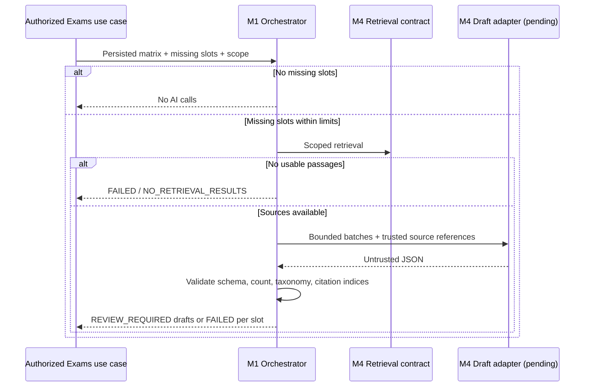

# M1-04 — Draft orchestration contract stage

Refs #16. Stacked on M1-03 / PR #88. This PR delivers the M1 contract and orchestration for live adapter integration once M2–M4 supply the provider and configuration.

## Consumer boundary

Exams owns IAiDraftGenerator as a proposed consumer port for the M4 adapter. AiDraftBatchRequest contains the already-authorized actor, school, department, subject/topic/difficulty, exact count, output token ceiling, stable correlation ID and passages from IKnowledgeRetriever. M4 must review this boundary before binding a real adapter. The existing M4/Knowledge implementation and contracts are untouched.

AiDraftOrchestrator accepts a persisted request ID, validated matrix and server-computed deficits. Its caller must recheck authorization and load those inputs from storage; this library is not an HTTP authorization boundary. It validates deficit count/score/taxonomy against the matrix before any provider call. An all-approved selection with no gaps calls neither retrieval nor generation.

Default operational ceilings: five questions per batch, 50 per request, ten slots, five retrieved passages per slot with 32000 total characters, 4096 output tokens per call, 64 KiB response JSON, 30 seconds per retrieval/batch and 120 seconds per request. These are configurable bounded implementation limits, not approved AWS quotas/cost estimates. Oversized requests are rejected as per-slot failures before provider calls. The adapter must honor cancellation and token bounds; cancellation of the awaiting task cannot guarantee cancellation/billing behavior of an external provider.

## Proposed provider JSON

```json
{
  "questions": [
    {
      "stem": "Question text",
      "options": ["A text", "B text", "C text", "D text"],
      "correctOption": "A",
      "difficulty": "EASY",
      "subjectId": "<requested subject UUID>",
      "topicId": "<requested topic UUID>",
      "sourceIndex": 0
    }
  ]
}
```

Unknown fields (including status/APPROVED) and duplicate JSON properties are rejected. Each batch must contain exactly the requested count. Taxonomy/difficulty must match, and content uses M4 McqContent validation. SourceIndex must identify a retrieved passage. Accepted citations come from the retrieval contract, which remains responsible for source permission and provenance. Each citation component is bounded to 1000 characters to fit the M1-05 mapping.

An entire slot succeeds as REVIEW_REQUIRED only when all its batches validate; malformed/partial/duplicate stems within a slot return FAILED with no publishable drafts. Slot outputs retain correlation IDs, and batch IDs derive from slot correlation plus offset. No drafts are saved here, so a retry cannot create database duplicates through this library. M1-05 must supply durable idempotent gap -> draft revision -> job mappings before runtime integration. Unexpected provider exceptions propagate to the future M5-facing handler for retry/error classification; known schema/no-retrieval/timeout failures have safe slot codes.



## Evidence and remaining work

Exams tests: 25 passed (12 new cases). New cases cover no-AI path, zero retrieval, bounded batches, invalid JSON, extra/missing count, wrong topic, model-supplied approval, invalid citation reference, pre-dispatch request ceiling, timeout and caller cancellation. These tests use test-only fakes, not AWS.

Still pending: M4 contract review/live adapter; region/model/KB and IAM/budget configuration from M2–M4; persisted request/result references, UI/job integration and retry classification; live RAG evidence; human review and integration CI. M1-05 and dependent finalization workflows must not claim completion until their providers and approval contracts are available. This issue remains incomplete.
