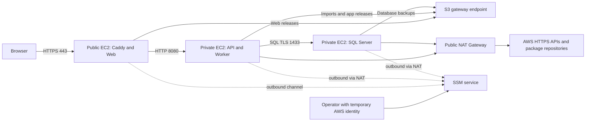
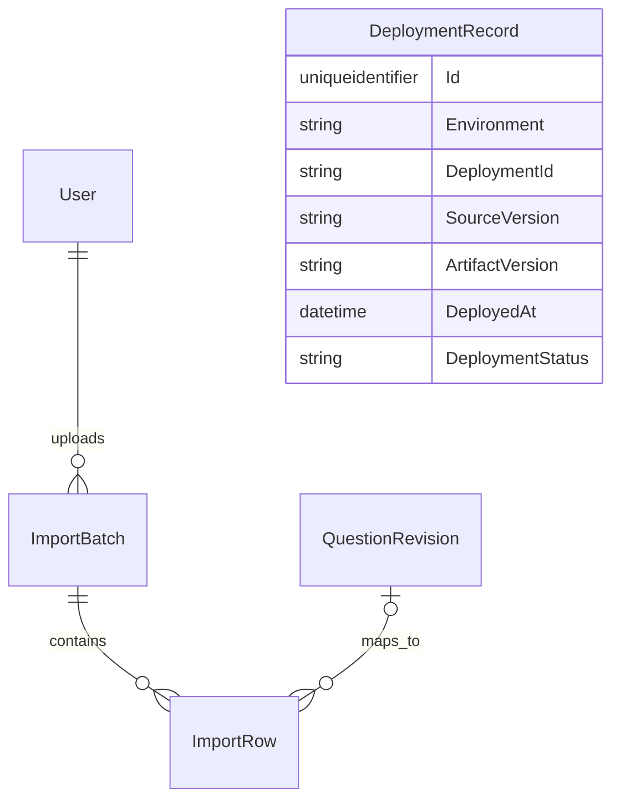

# M2-01 Deployment and Network Design and Import Contract

**Project:** AI Exam Bank

**Owner:** Nguyen Huynh Huu Phuoc - M2 / `HuuPhuoc-NH`

**Milestone:** W01 - Foundation and Contracts

**Updated:** 2026-10-17

**Status:** Design baseline prepared for implementation. Infrastructure decisions, import contracts, health contracts, wireframes and validation criteria are documented here. Cross-module interfaces remain design contracts until integrated and tested. This document does not claim that application features or AWS resources have been deployed.

This document defines the M2-owned deployment architecture and import/infrastructure-health interfaces for AI Exam Bank. The database engine is SQL Server, following the team's selected database technology. The baseline uses one non-production AWS staging environment, private application and database hosts, a public HTTPS entry point and Terraform-managed infrastructure. It provides the design inputs for M2-02 and later M2 implementation tasks in one document.

## 1. Goal

Define a reproducible, cost-conscious AWS deployment and network design, together with the CSV import and infrastructure-health contracts. The design must provide a clear HTTPS access path, private application/database boundaries, outbound AWS connectivity, protected infrastructure state and a secure administration path.

## 2. Context

AI Exam Bank uses a .NET modular monolith with a separate durable Worker process. API and Worker share module contracts and a relational database. The product supports multiple schools and Ministry-level examinations; resource scope must be enforced at the application boundary as well as in domain operations.

M2 owns AWS infrastructure, deployment design, CSV import and infrastructure health. M2-01 is a design deliverable. Provisioning, migrations, working endpoints, frontend implementation and live evidence belong to the corresponding implementation tasks. The existing `/health/live` endpoint reports process liveness only and is not proof of database, Worker or AWS readiness.

## 3. In Scope

- AWS Region, hosting, HTTPS entry, database hosting, egress strategy and cost planning.
- Network diagram, CIDR allocation, routes, security groups and traffic matrix.
- Terraform selection, remote state protection, locking, outputs and deployment principles.
- Infrastructure resource inventory, runtime access requirements and secret-delivery design.
- CSV schema, import API contracts, validation rules, idempotency and transaction semantics.
- SQL Server data design for ImportBatch, ImportRow and DeploymentRecord.
- Import and infrastructure-health wireframes and API response contracts.
- Validation scenarios, documentation evidence and implementation acceptance criteria.

## 4. Out of Scope

This task does not implement authentication, account administration, review/approval workflows, question-bank business rules or the durable job engine. It defines only the interfaces those capabilities expose to M2-owned features. Infrastructure and application runtime implementation are not presented as completed work in this document.

Kubernetes, microservices, production high availability, ALB, RDS and paid interface endpoints are not part of this baseline. Lex, SageMaker and VPN are optional extensions and do not block the core MVP. AI and infrastructure runtime identities cannot approve or publish examination content.

## 5. Deployment and Network Design

### 5.1. Deployment Decisions

| Concern | Selected baseline | Rationale and limits |
| --- | --- | --- |
| Region | `ap-southeast-1` - Singapore | Keep compute, storage and networking in one Region. Model/Knowledge Base availability, account access and quotas require separate live verification before AI integration. |
| Environment | One shared `staging` environment; local development | Avoid duplicating fixed infrastructure costs. Keep environment-specific configuration, state and secrets separate. |
| Operating system | Ubuntu Server 22.04 LTS, x86_64 | Consistent host administration and SQL Server 2022 compatibility. Pin tested AMI and package/CU versions during implementation. |
| Public entry | EC2 `t3.micro` running Caddy | Serve the compiled frontend and reverse-proxy API requests through one origin without an ALB. |
| HTTPS | Public domain mapped to entry Elastic IP; ACME TLS-ALPN on TCP 443 | Disable the HTTP challenge and HTTP redirect listener. TCP 80 remains closed. A valid domain, DNS record and persistent Caddy certificate storage are required. |
| Application host | Private EC2 `t3.small` | API and Worker run as separate systemd services on the same host. API listens on TCP 8080; Worker exposes no inbound service port. |
| Database | SQL Server 2022 Developer on private EC2 `t3.large` | Dedicated 8 GiB host. Initial SQL Server maximum server memory: 4096 MiB. Developer edition is for non-production development/test demonstrations only. |
| Database connection | SQL TLS on TCP 1433 using a dedicated application login | Use `Encrypt=True;TrustServerCertificate=False`; install the trusted CA and use a certificate matching the internal database hostname. The application does not use `sa`. |
| Entry-to-application connection | HTTP on TCP 8080, restricted by security groups | Public TLS terminates at the entry host. Internal HTTP is an explicit non-production limitation; this design does not claim end-to-end transport encryption. |
| Egress | One same-AZ zonal public NAT Gateway and an S3 gateway endpoint | NAT supports AWS APIs and software repositories. S3 traffic uses the gateway endpoint. |
| Administration | SSM Session Manager | No inbound SSH or RDP. Hosts require SSM Agent, instance profiles and outbound service connectivity. |
| Infrastructure as Code | Terraform `>= 1.10, < 2.0` | Reviewable plans, reproducible changes and remote state with native S3 locking. Pin provider constraints and commit the dependency lockfile. |
| Secret delivery | Parameter Store Standard `SecureString`, two separate symmetric customer-managed KMS keys | One app key and one DB key; exact parameter/key permissions, SSM service and encryption-context conditions. Secret values remain outside Terraform. |
| Logging | CloudWatch Logs with 14-day retention | Host/application logs and standard SSM shell session logs; exclude secrets, answer keys and raw imported content. |
| Resource naming | `aieb-staging-*` | Bucket names also include the account ID and Region. Tags: Project, Environment, Owner, ManagedBy and CostCenter. |

### 5.2. Network Diagram



The environment uses one Availability Zone and has single-instance failure points. It is a demonstration environment, not a production HA topology.

### 5.3. VPC, Subnets and Routes

| Component | Configuration | Routing and controls |
| --- | --- | --- |
| VPC | `10.20.0.0/16` | Enable DNS support and DNS hostnames. Check for overlap before the first apply. |
| Public subnet | `10.20.1.0/24` | Entry host and NAT Gateway; `0.0.0.0/0` routes to the Internet Gateway. |
| Private application subnet | `10.20.11.0/24` | No public IPv4 on the application host; default route to NAT. |
| Private database subnet | `10.20.21.0/24` | No public IPv4 on the database host; default route to NAT. |
| S3 gateway endpoint | Associate with public and private route tables | The S3 prefix-list route targets the endpoint. It is not a replacement target for the default route. |
| Availability Zone | Select and pin an available AZ in Singapore through configuration | Place all three subnets and the zonal NAT in the same AZ. AZ names across accounts must not be assumed to identify the same physical zone. |

IPv6 is not enabled in this baseline. Use the default network ACL and explicit stateful security-group rules, supplemented by host firewall configuration. NAT Gateways do not have security groups.

### 5.4. Security Groups and Traffic Matrix

| Source | Destination | Port or protocol | Decision |
| --- | --- | --- | --- |
| Internet | `sg-entry` | TCP 443 | Allow HTTPS for the frontend and API through one entry point. |
| Internet | Any host | TCP 22, 80, 3389 | Deny inbound access. |
| Internet | Application/database hosts | TCP 8080, 1433 and other inbound ports | Deny; both hosts have no public IPv4 address. |
| `sg-entry` | `sg-app` | TCP 8080 | Allow reverse-proxy traffic only. |
| `sg-entry` | `sg-db` | TCP 1433 | Deny direct database access. |
| `sg-app` | `sg-db` | TCP 1433 | Allow the SQL TLS connection. Database authentication remains mandatory. |
| Host security groups | AWS APIs, software repositories and ACME services | TCP 443 outbound | Allow; private hosts use NAT. Security groups do not enforce domain-name allowlists. |
| Host security groups | S3 prefix list | TCP 443 outbound | Allow through the gateway endpoint, subject to endpoint and bucket policies. |
| Hosts | VPC DNS resolver and AWS Time Sync | Platform DNS/time traffic | Use AWS-provided services. Security groups do not filter DNS traffic to AmazonProvidedDNS. |
| SSM service | Host inbound ports | None | Agents establish outbound channels; no inbound administration port is opened. |

### 5.5. Resource and Storage Inventory

| Resource | Quantity | Baseline |
| --- | ---: | --- |
| VPC | 1 | DNS-enabled, `10.20.0.0/16` |
| Subnets | 3 | Public entry, private application and private database |
| Internet Gateway | 1 | Attached to the VPC |
| Zonal public NAT Gateway | 1 | Same AZ as private hosts |
| Elastic IP addresses | 2 | Entry host and NAT |
| EC2 instances | 3 | Entry `t3.micro`, app `t3.small`, database `t3.large` |
| Host security groups | 3 | Entry, application and database |
| Instance profiles | 3 | Separate entry, application and database profiles |
| S3 gateway endpoint | 1 | Route-table associations and restricted endpoint policy |
| S3 buckets | 2 | Application data and Terraform state, kept separate |
| EBS gp3 volumes | 4 | Entry root 16 GiB, app root 24 GiB, DB root 24 GiB, DB data 40 GiB |

All EBS volumes are encrypted. Preserve the database data volume when replacing the instance, mount by filesystem UUID and take a verified backup before migrations or volume changes. Use T3 Standard credit mode to avoid surplus-credit charges; monitor CPU throttling before increasing instance sizes.

Both S3 buckets use public access block, BucketOwnerEnforced ownership, SSE-S3 and TLS-only bucket policies. The data bucket has these prefixes:

| Prefix | Use | Access boundary |
| --- | --- | --- |
| `imports/` | Uploaded CSV files and import artifacts | Application read/write; server-generated keys include batch/scope references. |
| `releases/web/` | Compiled frontend releases | Deployment write; entry host read only. |
| `releases/app/` | API/Worker releases | Deployment write; application host read only. |
| `backups/sql/` | SQL Server backup files | Database backup/restore access; no application access. |

Original user filenames are metadata, not trusted object paths. Runtime identities cannot access the separate state bucket.

### 5.6. Terraform and State Design

Use separate bootstrap and application stacks. The bootstrap stack creates a private state bucket with versioning, encryption, TLS-only access, public access block and `prevent_destroy`; do not enable `force_destroy`. Its initial local state is restricted to the operator's machine and migrated to `bootstrap/terraform.tfstate` immediately after creation. Verify remote state before removing the local copy. An application-stack destroy must not delete the state bucket.

The staging stack uses:

```hcl
key          = "staging/infrastructure/terraform.tfstate"
region       = "ap-southeast-1"
encrypt      = true
use_lockfile = true
```

The actual globally unique bucket name is supplied as non-secret backend configuration. State access is limited to the deployment identity: prefix-restricted ListBucket, GetObject/PutObject for the state object and GetObject/PutObject/DeleteObject for its `.tflock`. Do not use S3 Object Lock for the lock file. No DynamoDB lock table is required for this Terraform baseline.

Implementation layout: `infrastructure/bootstrap` and `infrastructure/environments/staging`. Commit `.terraform.lock.hcl`; exclude `.terraform/`, saved plans, state, real tfvars and credentials. Verify the account with `sts get-caller-identity`, configure allowed account IDs and pin the Region. Run format/validate, review a saved plan, apply that plan, then re-plan to check for unexpected changes.

Required outputs: Region, VPC/subnet/security-group/instance IDs, entry EIP, bucket names, role/profile names and the public health URL. Outputs containing internal resource identifiers are operator-only. Never output secret values, including outputs marked `sensitive`.

### 5.7. Deployment Decision Record

| Decision | Alternatives considered | Consequence |
| --- | --- | --- |
| Private SQL Server Developer on EC2 | RDS SQL Server or SQL Server Express | Developer fits non-production feature testing; EC2 requires database patching, backups and restore procedures. Production needs a separate licensing/hosting decision. |
| EC2 Caddy entry | ALB or a public application host | Avoid ALB fixed cost while preserving the private application boundary; entry availability and certificate storage become operational responsibilities. |
| NAT Gateway with S3 gateway endpoint | NAT instance or interface-endpoint-only egress | Avoid operating a NAT instance and support software downloads. NAT introduces a fixed hourly cost; this is not a claim that it is always the cheapest option. |
| S3 native locking | Shared local state or a new DynamoDB lock table | Protect team state without adding a locking database. |
| Parameter Store with separate app/DB CMKs | Secrets Manager or a shared/default key | Suitable for the small staging secret set; separate decrypt boundaries, manual rotation and additional KMS key charges. |

These are M2 deployment decisions. They do not change shared authentication, question-domain or job-engine implementation ownership.

## 6. Dependencies and Integration Boundaries

M2-01 depends on the architecture and shared module contracts from M1-01. User/role identity, question revision references and durable job interfaces are integration dependencies; this document specifies their use by M2-owned features without implementing those modules.

| Interface or input | M2 usage |
| --- | --- |
| Shared persistence model | One SQL Server database and one coordinated EF Core migration stream. |
| Authenticated actor and resource scope | Authorize import access and protect infrastructure-health responses. |
| Question catalog and revision writer | Resolve subject/topic and create DRAFT revisions inside the import transaction. |
| Durable job tracking | Persist validation/commit work, expose operation status and recover interrupted processing. |
| AWS account and temporary deployment identity | Validate quotas, resource permissions and the target account before applying infrastructure. |
| Domain and DNS | Obtain and verify the public entry certificate. |

Missing integration inputs are recorded against the affected implementation check. They do not justify bypassing authorization, exposing the database or claiming mock behavior as live deployment proof.

## 7. Required Deliverables

### 7.1. CSV Schema and Validation Contract

Accept UTF-8 CSV, with or without BOM. Use a CSV parser that supports quoted commas and embedded newlines. The maximum upload is 5 MiB and 1,000 data records. Accept `.csv` with `text/csv` or `application/octet-stream`, but validate the extension, encoding, header and parsed structure independently of MIME type.

| Column | Required | Validation |
| --- | --- | --- |
| subject | Yes | Trimmed non-empty text, maximum 200 characters; resolve within the actor's authorized catalog. |
| topic | Yes | Trimmed non-empty text, maximum 200 characters; resolve within the selected subject/scope. |
| difficulty | Yes | Normalize to lower case: `easy`, `medium` or `hard`. |
| question_text | Yes | Non-empty text, maximum 4,000 characters. |
| option_a, option_b, option_c, option_d | Yes | Four non-empty choices, each at most 1,000 characters. |
| correct_option | Yes | Normalize to upper case A/B/C/D; exactly one correct answer. |
| source | No | Provenance description or URL, maximum 2,000 characters; no automatic fetching of user-supplied URLs. |

School, department and examination-event scope are not trusted CSV fields. The server validates the upload context against the authenticated actor. Import does not automatically create subject/topic taxonomy. Malformed CSV or an invalid header rejects the whole upload; a structurally valid file with row errors produces a preview.

Render content and errors as text, avoid raw-content logs and protect spreadsheet exports against formula injection. `rowNumber` identifies the logical CSV record, with the header numbered 1; it is not necessarily the physical line number when quoted fields contain newlines.

### 7.2. Import and Health API Contracts

Use `/api/v1` for business routes, consistent with the shared API design. This replaces the unversioned proposed routes in the earlier M2-01 document; no compatibility alias is required before consumers exist. Authentication/policy names below describe the M2 endpoint boundary, not a completed authentication implementation.

| Method | Endpoint | Request or response | Access requirement |
| --- | --- | --- | --- |
| POST | `/api/v1/imports/upload` | Multipart `file` and authorized context; 202 after batch/validation job persistence | `Imports.Write` and valid resource scope |
| GET | `/api/v1/imports/{batchId}/preview` | 200 with batch status, counts and paginated rows/errors | `Imports.Read`, ownership and scope |
| POST | `/api/v1/imports/{batchId}/commit` | `Idempotency-Key` header; 202 for the operation, or 200 for its completed stored result | `Imports.Write`, ownership and scope |
| GET | `/api/v1/imports/{batchId}/result` | 200 with operation/batch status, counts and authorized result links | `Imports.Read`, ownership and scope |
| GET | `/api/v1/admin/infrastructure/health` | 200 with a safe component/deployment snapshot | Explicit `InfrastructureHealth.Read` grant |

Import is available to an authorized Teacher in the assigned scope. Administrative roles do not automatically bypass batch ownership or resource boundaries. A global infrastructure-health grant is separate from school/Ministry business roles and grants no question approval or role-management rights.

Return 401 when unauthenticated and 403 when a policy grant is missing. For a batch outside the caller's scope, return 404 to avoid exposing its existence. Do not trust user IDs or scope values from the request as authorization evidence. Cookie-authenticated mutations require CSRF protection; the frontend and API share one HTTPS origin.

Errors follow RFC Problem Details with `status`, `title`, stable `code` and `traceId`; no stack traces or SQL details. Use 400 for invalid input/header/CSV structure, 413 for an oversized file, 415 for unsupported file type and 409 for state/version/idempotency conflicts. OpenAPI is generated and verified with the working endpoint implementation.

### 7.3. Batch State and Commit Semantics

```text
UPLOADED -> VALIDATING -> READY -> COMMITTING -> COMMITTED
                      -> INVALID
```

INVALID means no valid rows remain. A batch containing both valid and invalid rows can become READY. Preview results distinguish validation counts from commit counts. A commit creates DRAFT question revisions for valid rows and preserves validation errors for invalid rows; it does not approve content.

Commit before READY returns 409 `BATCH_NOT_READY`. A batch with zero valid rows cannot start a commit. Infrastructure or database failures are not converted into ordinary row validation errors or reported as successful partial commits.

For the 1,000-row limit, use an atomic transaction for all valid rows: question revision writes, row mappings and final batch results commit together. A failure rolls the transaction back. The question writer participates in the shared SQL transaction. Persisting the idempotency key, COMMITTING transition and durable commit job is also atomic. Worker recovery must preserve the same operation and must not reset a completed batch.

### 7.4. Idempotency Contract

| Concern | Convention |
| --- | --- |
| Location | HTTP `Idempotency-Key` header; not body or query string. |
| Format | Client-generated UUID v4 when a commit operation starts; retained on Retry. |
| Persistence | Store key, batch reference, normalized request fingerprint and operation/result reference. |
| Same key, batch and payload | Return the existing operation (202) or completed stored result (200); create no additional job or questions. |
| Key bound to a different batch or payload | After authorization, return 409 `IDEMPOTENCY_KEY_CONFLICT`. |
| Missing or invalid header | 400 `IDEMPOTENCY_KEY_REQUIRED`; no mutation. |
| New key on a committed batch | 409 `BATCH_ALREADY_COMMITTED`; no new questions. |
| Retention | Keep key/result at least 30 days; never expire an active operation. Preserve a commit tombstone after archiving so the batch cannot commit again. |

A UUID alone does not guarantee exactly-once effects. Use database uniqueness, transaction boundaries and durable recovery. Re-uploading the same file creates a new batch; domain-wide duplicate detection is not claimed by this contract.

### 7.5. SQL Server Data Design

Use EF Core's SQL Server provider with one shared DbContext/migration stream. M2-owned entities do not create an independent identity table or a separate health database. External foreign keys must match the actual shared identity/question schema before migration.

Identifiers use GUID/`uniqueidentifier` as the baseline. Store UTC times as `datetime2(3)`, statuses as bounded `nvarchar`, Unicode content with explicit length limits and JSON as `nvarchar(max)` with an ISJSON check for non-null values. Use SQL Server `rowversion` for optimistic concurrency; it is not a wall-clock timestamp.

| Entity | Fields | Constraints and purpose |
| --- | --- | --- |
| ImportBatch | Id, UploadedBy, SchoolId, DepartmentId, optional ExamEventId, FileName, ObjectKey, Status, TotalRows, ValidRows, InvalidRows, CreatedAt, CommittedAt, IdempotencyKey, RequestHash, CommitJobId, RowVersion | Non-negative counts; valid + invalid equals total after validation. Unique filtered IdempotencyKey index where not null. Scoped ownership and shared foreign keys. |
| ImportRow | Id, BatchId, RowNumber, NormalizedValues, ValidationStatus, ErrorCode, ErrorMessage, QuestionRevisionId | Unique (BatchId, RowNumber); batch foreign key; nullable question-revision reference until commit. |
| DeploymentRecord | Id, Environment, DeploymentId, SourceVersion, ArtifactVersion, DeployedBy, DeployedAt, DeploymentStatus, Notes | Unique (Environment, DeploymentId). DeploymentId is a pipeline run/attempt reference or UUID; the same artifact can be redeployed or rolled back in a new record. |

DeploymentStatus uses SUCCEEDED/FAILED/ROLLED_BACK. DeployedBy identifies a deployment principal and is not forced to reference a human User. Current component health is a separate snapshot, not a replacement for deployment history.



### 7.6. Infrastructure Health Contract

Return UNKNOWN when a component has not been checked, has no configuration or has stale evidence. Return DOWN for a current failed probe and UP only for a successful current probe. Evidence is fresh for five minutes. Probe timeouts are at most two seconds each and five seconds overall; use a cached snapshot rather than listing AWS inventory on each page refresh. Do not invoke a paid model as a health probe.

Initial response when no real checks or deployment records exist:

```json
{
  "status": "UNKNOWN",
  "checkedAt": null,
  "environment": "staging",
  "deployment": null,
  "components": [
    { "name": "database", "status": "UNKNOWN", "checkedAt": null },
    { "name": "storage", "status": "UNKNOWN", "checkedAt": null },
    { "name": "ai", "status": "UNKNOWN", "checkedAt": null }
  ],
  "traceId": "example-trace-id"
}
```

Aggregate precedence is DOWN, then UNKNOWN, then UP; all required checks must be fresh and successful for aggregate UP. AI being UNKNOWN does not block readiness of core workflows that do not use AI. The protected snapshot endpoint returns 200 even for a DOWN snapshot; a machine-oriented readiness endpoint returns 503 when not ready once implemented. Send `Cache-Control: no-store` for the protected response.

Deployment information exposes only source/artifact version and deployment time. Never expose private IPs, internal database hostnames, ARNs, parameter paths, credentials, raw exceptions or examination content. Deployment records are written through a controlled internal deployment command after migration/smoke checks, not through a public browser-write endpoint. Working pipeline integration is a later M2 implementation deliverable.

### 7.7. Import and Health Wireframes

```text
[UPLOAD CSV]
File: [Browse]       Limit: 5 MiB / 1,000 data records
Context: authorized school/department or assigned event
Required columns: subject, topic, difficulty, question_text, ...
                                             [Upload]

[PREVIEW]
Status: READY       Total: 5       Valid: 1       Invalid: 4
Row | Field | Error code | Message
Pages: 50 records per page
                           [Cancel] [Commit valid rows]

[COMMIT AND RESULT]
Operation: queued / running / completed / retryable failure
Created DRAFT: __       Invalid rows skipped: __
[View results] [Retry using the same Idempotency-Key]

[INFRASTRUCTURE HEALTH]
Environment | Source version | Artifact version | Last deployed
Database: UNKNOWN | Storage: UNKNOWN | AI: UNKNOWN
Checked at: --
Message: No verified health result is available yet.
```

Only show actions permitted by the authenticated context; the server repeats authorization. Disable commit until READY and at least one valid row exists. The health panel never renders UNKNOWN as a successful green check.

### 7.8. Runtime Access and Secret Requirements

These are the access requirements of M2-owned infrastructure, not assignments for another task owner.

| Identity | Required access | Excluded access |
| --- | --- | --- |
| Entry instance profile | EC2 trust, SSM core, entry log streams, read `releases/web/` | Database secrets, backups, state, AI services |
| Application instance profile | EC2 trust, SSM core, app logs, scoped list/read/write `imports/`, read `releases/app/`, read its connection-string parameter | Database bootstrap secret, backups, state, IAM administration or content approval |
| Database instance profile | EC2 trust, SSM core, database logs, write backups and controlled restore reads, read its bootstrap parameter | Imports, state, AI services or IAM administration |
| Human operator | Temporary identity, scoped SSM session access and own-session resume/termination | Unrelated project resources or ungranted secrets |
| Deployment identity | Infrastructure operations for the reviewed plan, backend state/lock access and PassRole for the three named EC2 roles | Changing its own trust/boundary or unrestricted PassRole |

Use exact parameters `/aieb/staging/app/connection-string` and `/aieb/staging/db/bootstrap-password`. Do not grant a recursive parent-path read spanning both. Separate database bootstrap, migration and application principals. SSM core includes service-required actions whose resource cannot be narrowed to a single instance ARN; record such exceptions explicitly. Instance-agent permissions do not grant a human permission to start sessions.

The selected infrastructure integration uses pre-created `aieb-staging-entry-profile`, `aieb-staging-app-profile` and `aieb-staging-db-profile`, with matching `*-role` names, administered outside the staging stack. Each role has its runtime policy, managed SSM core and a reviewed permissions boundary. Explicit denies restrict the managed policy's broad parameter reads: entry reads no secrets, app reads only its connection string, and DB reads only its bootstrap secret. Path/history access and cross-secret KMS decrypt remain blocked.

Use two separately administered symmetric CMKs with exact SSM `kms:ViaService` and `kms:EncryptionContext:PARAMETER_ARN` conditions. Separate custodians write their own Standard SecureString with the corresponding key and do not receive routine read-back. Secret resources/values, role/profile creation, key policies and Session Manager preferences remain outside the default Terraform execution role. Local JSON rendering and review checks are provided in [security preparation](../infrastructure/security/README.md); they do not establish live IAM correctness or third-party approval.

Deployment PassRole is limited to the named instance roles and `ec2.amazonaws.com`, with constrained role templates/permissions boundaries. If the account does not allow role creation, use existing authorized profiles instead of escalating to AdministratorAccess. AI access is added only for the actual model/Knowledge Base resources used by later integration.

Secret values are provisioned outside Terraform; IaC manages names and permissions, not passwords in state or user-data. Services retrieve secrets through their instance roles at startup and use restricted files under `/run` where needed. Missing secrets fail readiness explicitly. Do not log values or use default-password fallbacks.

Standard shell sessions use CloudWatch session logging. Port-forwarding sessions, if separately permitted, must not be represented as having a captured shell transcript. SQL backups run daily while the environment is active, before migrations and before handover. Use SIMPLE recovery for the demo; retain seven recent full backups plus handover backups. Restore validation and measured recovery objectives require later live exercises. Code rollback does not automatically reverse destructive migrations.

The session log group is `/aieb/staging/ssm-sessions`, retained for 14 days. A named temporary M2 operator may open standard shell sessions on entry/app; database shell access requires a separate DBA/break-glass grant. Use a reviewed account-owned shell document and caller-specific session scope. Shell/sudo access is privileged even if direct secret API access is denied.

## 8. Validation Plan

### 8.1. CSV Fixtures

Valid example:

```csv
subject,topic,difficulty,question_text,option_a,option_b,option_c,option_d,correct_option,source
Math,Algebra,easy,"What is 2 + 3?",4,5,6,7,B,Grade 6 Textbook
Computer Science,Networking,medium,"Which protocol is used for secure web browsing?",HTTP,FTP,HTTPS,SMTP,C,Computer Networking Coursebook
Physics,Mechanics,hard,"What is the SI unit of force?",Joule,Newton,Watt,Pascal,B,Grade 10 Textbook
```

Invalid example with row-level errors:

```csv
subject,topic,difficulty,question_text,option_a,option_b,option_c,option_d,correct_option,source
Math,Algebra,easy,"What is 2 + 3?",4,5,6,7,B,Grade 6 Textbook
Math,Algebra,easy,"What is 3 + 3?",5,6,,8,B,
Math,Algebra,easy,"What is 4 + 4?",6,7,8,9,E,
Math,Algebra,extreme,"What is 5 + 5?",9,10,11,12,B,
Math,Algebra,easy,,1,2,3,4,A,
```

| Logical record | Expected result | Error code |
| --- | --- | --- |
| 2 | VALID | None |
| 3 | INVALID: option_c is missing | `MISSING_REQUIRED_FIELD` |
| 4 | INVALID: correct_option is outside A/B/C/D | `INVALID_CORRECT_OPTION` |
| 5 | INVALID: difficulty is outside the enum | `INVALID_DIFFICULTY` |
| 6 | INVALID: question_text is empty | `MISSING_REQUIRED_FIELD` |

Expected preview: five data records, one valid and four invalid. Additional validation codes include `UNKNOWN_SUBJECT_OR_TOPIC` and `FIELD_TOO_LONG`.

### 8.2. Application and Infrastructure Cases

| Case | Expected result | Evidence required during implementation |
| --- | --- | --- |
| Valid CSV upload | Batch and validation operation persisted; preview counts correct | API response and database assertions |
| Malformed/non-CSV/oversized input | Clear 400/415/413; no unintended domain changes | Negative API cases |
| Mixed valid/invalid rows | Correct field/record errors; valid rows remain committable | Preview UI and API |
| Concurrent same-key commit/retry | One operation and no duplicate DRAFT revisions | Transaction/concurrency assertions |
| Missing header or conflicting key | 400 or 409 with stable code; no extra writes | Negative API/database cases |
| Worker failure during commit | Atomic rollback and safe recovery of the existing operation | Failure-injection evidence |
| Unauthenticated or insufficient-policy caller | 401 or 403; cross-scope batch access returns 404 | Direct API permission cases |
| Health without a probe | UNKNOWN; no fabricated deployment or UP state | API/UI snapshot |
| Failed/stale component check | DOWN/UNKNOWN according to freshness rules | Probe/failure cases |
| Health response redaction | No secrets or internal configuration | Response inspection |
| Terraform lifecycle | Validated plan/apply; subsequent plan has no unexpected changes | Redacted outputs and source version |
| Network boundaries | No public app/DB IP; traffic matches section 5.4 | Routes/SG inventory and reachability checks |
| SSM administration | Hosts online; real shell session succeeds for an authorized operator | Redacted session evidence |
| SQL persistence | Clean migration, validated TLS and restricted application login | SQL Server integration evidence |
| Secret isolation | Application cannot read state/backup/bootstrap secrets | Permission checks and log/state review |
| HTTPS entry | Valid public certificate and DNS; no certificate-error bypass | Browser/API TLS verification |

These are planned validation cases. No runtime result is marked passed by this design document. Mocks do not establish deployment proof.

## 9. Cost and Documentation Evidence

### 9.1. Cost Worksheet

Use USD 250/month as a planning threshold for the infrastructure baseline only. This is not an approved spending commitment or an AWS quote. The worksheet uses conservative planning assumptions for EC2/NAT/EBS; replace them with a Singapore Pricing Calculator or Price List quote for the actual configuration before apply. Do not assume Free Tier or account credits.

| Item | Planning assumption | 730-hour month |
| --- | --- | ---: |
| Entry t3.micro Linux | USD 0.020/hour | USD 14.60 |
| Application t3.small Linux | USD 0.040/hour | USD 29.20 |
| Database t3.large Linux | USD 0.120/hour | USD 87.60 |
| One NAT Gateway | USD 0.070/hour, excluding data | USD 51.10 |
| Two public IPv4 addresses | 2 x USD 0.005/hour | USD 7.30 |
| EBS gp3, 104 GiB | USD 0.120/GiB-month | USD 12.48 |
| Two customer-managed symmetric KMS keys | 2 x USD 1/month before rotation; usage requests included in the small-demo allowance | USD 2.00 |
| S3, requests, logs, NAT data and transfer | Small-demo allowance; measure actual usage | USD 20.00 |
| Infrastructure total | Excludes tax, domain, Bedrock, KB and vector store | **USD 224.28** |

The IPv4 rate is based on the linked VPC pricing page; the EC2/NAT/EBS amounts are planning allowances rather than verified Singapore unit rates. S3 gateway endpoints do not add hourly or endpoint data-processing fees; underlying service charges still apply.

Target approximately 100 EC2 running hours per month for integration/demo sessions. If EC2 is stopped outside these sessions but NAT/EIP/EBS and the two secret keys remain for the full month, the same assumptions produce **USD 110.88/month**. EC2 stop does not stop NAT, allocated IPv4, key storage or disk charges. NAT must be explicitly removed to stop its hourly charge. Preserve data, state and backups rather than applying an indiscriminate destroy. KMS request volume, key rotation and account-specific costs must be included in the actual quote.

Configure actual-cost alerts at 50%, 80% and 100%, plus forecast 100%, when a recipient is available. AWS Budgets is not a hard spending cap. AI/vector-store usage and domain costs require their own cost worksheet; the USD 250 infrastructure threshold is not a total-project budget.

### 9.2. Design Evidence

| Deliverable | Location in this document | Status |
| --- | --- | --- |
| Deployment decisions and trade-offs | Sections 5.1 and 5.7 | Documented |
| Network diagram, routes and traffic matrix | Sections 5.2-5.4 | Documented |
| Inventory, state and outputs | Sections 5.5-5.6 | Documented |
| CSV/API/data/idempotency contracts | Sections 7.1-7.5 | Documented |
| Health response and wireframes | Sections 7.6-7.7 | Documented |
| Runtime access and secret design | Section 7.8 | Documented |
| Fixtures and validation expectations | Section 8 | Documented; runtime execution pending |
| Cost assumptions and lifecycle | Section 9.1 | Documented; account-specific quote pending |

### 9.3. Implementation Evidence

Live evidence must include a source/release version, environment and timestamp, with sensitive values redacted. Required items are Terraform plan/apply/re-plan outputs, resource inventory, SSM session evidence, private-boundary checks, SQL migration/TLS results and protected health API/UI results. Later deployment evidence includes pipeline metadata and rollback/restore exercises.

Executable OpenAPI, deployment/SSM runbooks and secret-free configuration examples accompany the implemented features. This design does not label unimplemented endpoints, planned commands or mock screenshots as completed runtime evidence.

## 10. Acceptance Criteria

### 10.1. M2-01 Design Deliverable

- [x] Region, hosting, SQL Server, HTTPS entry and outbound connectivity are defined.
- [x] Network diagram, CIDRs, routes, security groups and allowed/denied traffic are documented.
- [x] Terraform tool, state protection, locking and outputs are specified.
- [x] Resource inventory and cost worksheet include explicit assumptions and lifecycle limits.
- [x] CSV, API, data model, idempotency and transaction contracts are defined.
- [x] Import and health wireframes cover normal, error and UNKNOWN states.
- [x] Runtime access requirements, secrets and validation expectations are documented.

These checked items confirm the presence of design content. They do not certify deployment, peer approval or successful runtime testing.

### 10.2. Implementation and Delivery Gates

- [ ] Relevant API/UI/failure/permission cases pass with linked results.
- [ ] Live AWS evidence verifies the applicable MUST requirements.
- [ ] The deployed infrastructure is reproducible and has no unexplained drift.
- [ ] Secrets and internal configuration are excluded from public responses, source and logs.
- [ ] The delivery PR passes relevant checks and the repository review process.
- [ ] Actual Hours, issue checklist and Project status reflect verified work.

## 11. Risks and Operational Limits

Single-AZ infrastructure and individual EC2 hosts can fail without automatic service continuity. SQL Server Developer is limited to non-production use. Entry-to-application HTTP is a documented demo limitation. T3 credit exhaustion can reduce performance; NAT, public IPv4 and storage costs persist when application instances are stopped.

Account permissions, service quotas, domain/DNS, certificate trust and unimplemented shared contracts may prevent individual implementation checks from passing. Record a blocker only after confirming the specific condition, and identify the next action for the affected M2 work. Never resolve a blocker by exposing private services, disabling authorization or granting unrestricted administrative privileges.

## 12. PR Evidence and Work Log

| Item | Record |
| --- | --- |
| Earlier document baseline | PR #67, present in the local repository history |
| This revision | English M2-01 design document, dated 2026-10-16 |
| Current delivery state | Local document revision; no new commit, push or PR recorded here |
| Runtime evidence | Pending implementation; no runtime success claimed |
| Actual Hours | To be recorded from the owner's actual work; not inferred from estimates |

Record the final PR, check results, review evidence and actual work hours when those events occur. Do not substitute design completion for application or AWS delivery completion.

## 13. References

Technical references were consulted on 2026-10-16. They support the design, not account-specific deployment claims.

- [SQL Server 2022 editions](https://learn.microsoft.com/en-us/sql/sql-server/editions-and-components-of-sql-server-2022/)
- [SQL Server on Linux platforms](https://learn.microsoft.com/sql/linux/sql-server-linux-setup?view=sql-server-linux-ver16)
- [EF Core SQL Server provider](https://learn.microsoft.com/en-us/ef/core/providers/sql-server/)
- [Terraform S3 backend](https://developer.hashicorp.com/terraform/language/backend/s3)
- [Caddy automatic HTTPS](https://caddyserver.com/docs/automatic-https)
- [SSM instance permissions](https://docs.aws.amazon.com/systems-manager/latest/userguide/setup-instance-permissions.html)
- [SSM connectivity](https://docs.aws.amazon.com/systems-manager/latest/userguide/setup-create-vpc.html)
- [SSM message endpoints](https://docs.aws.amazon.com/systems-manager/latest/userguide/systems-manager-setting-up-messageAPIs.html)
- [Parameter Store](https://docs.aws.amazon.com/systems-manager/latest/userguide/systems-manager-parameter-store.html)
- [SecureString encryption](https://docs.aws.amazon.com/systems-manager/latest/userguide/secure-string-parameter-kms-encryption.html)
- [KMS pricing](https://aws.amazon.com/kms/pricing/)
- [EC2 On-Demand pricing](https://aws.amazon.com/ec2/pricing/on-demand/)
- [VPC, NAT and IPv4 pricing](https://aws.amazon.com/vpc/pricing/)
- [EBS pricing](https://aws.amazon.com/ebs/pricing/)
- [AWS Pricing Calculator](https://calculator.aws/)
- [AWS Budgets](https://docs.aws.amazon.com/cost-management/latest/userguide/budgets-managing-costs.html)
- [T3 Standard credit mode](https://docs.aws.amazon.com/AWSEC2/latest/UserGuide/burstable-performance-instances-standard-mode.html)
