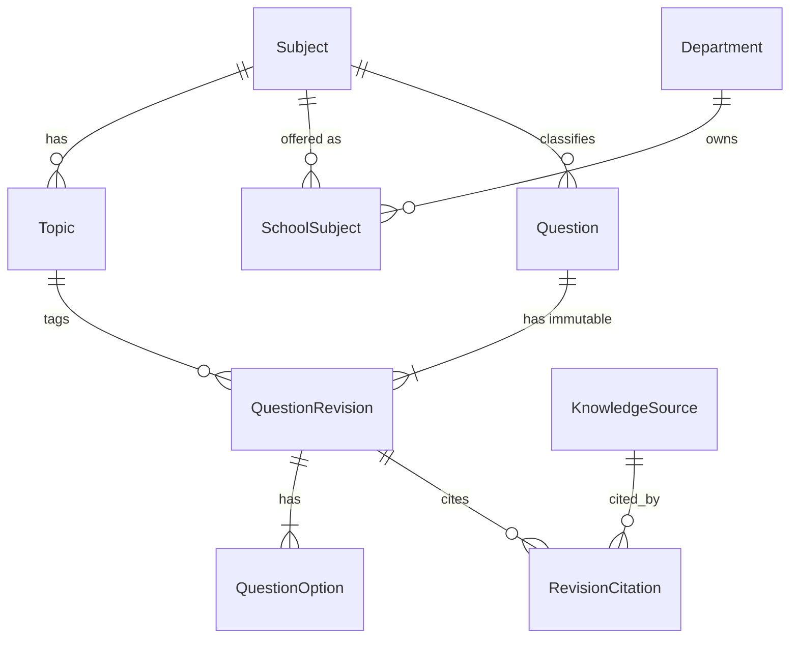

# M4-01 — Question domain, taxonomy và seed

**Status:** Proposed cho M1, M2, M3 review; chưa có migration hay code. Đây là thiết kế, không phải chức năng hiện có.
**Người thực hiện:** Thiên Phúc (M4). **Ngày:** 2026-10-28.
**Liên quan:** [Architecture](ARCHITECTURE.md), [thiết kế solution .NET](DOTNET_SOLUTION_DESIGN.md), [M2-01 CSV contract](M2-01_deploy_network.md), [M3-02 schema handoff](M3-02_identity_schema_handoff.md), [phân quyền](IDENTITY_AND_PERMISSIONS.md).

Tài liệu này chốt các contract M4-02 (CRUD/search), M1-02 (blueprint), M2-03 (import) và M3-03 (review) cùng dùng. Phần RAG/AWS nằm ở mục 9 và không chặn M4-02.

## 1. Quyết định phạm vi MVP

| Hạng mục | Quyết định | Nguồn |
|---|---|---|
| Cấp học, khối | THPT, khối 12 | Project owner, 2026-10-28 |
| Môn | Toán, Vật lý, Hóa học | Project owner, 2026-10-28 |
| Môn ↔ Department | Mỗi môn trong một trường do đúng một Department phụ trách | Project owner, 2026-10-28 |
| Dạng câu hỏi | MCQ 4 lựa chọn A–D, đúng một đáp án | Plan M4-01 bước 1, khớp CSV M2-01 |
| Trạng thái đầu của nội dung mới | `DRAFT`, kể cả import, AI và tạo tay | Plan M4-02 |

Tài liệu nguồn đã có nhưng **không đưa vào repo** (mục 9). Danh sách chủ đề ở mục 3 phải đối chiếu với tài liệu đó trước khi chốt.

## 2. Mô hình dữ liệu

`School`, `Department`, `AspNetUsers` do M3 sở hữu; M4 chỉ tham chiếu qua ID và thêm migration vào cùng stream.

| Bảng | Cột chính | Ràng buộc |
|---|---|---|
| `Subjects` | `Id`, `Code`, `Name` | `Code` unique; seed cố định, không tạo từ import |
| `Topics` | `Id`, `SubjectId`, `Code`, `Name` | Unique `(SubjectId, Code)`; alternate key `(Id, SubjectId)` |
| `SchoolSubjects` | `SchoolId`, `SubjectId`, `DepartmentId` | PK `(SchoolId, SubjectId)` để một môn chỉ thuộc một Department; FK `(DepartmentId, SchoolId)` tới `Departments` |
| `Questions` | `Id`, `SchoolId`, `DepartmentId`, `SubjectId`, `OwnerUserId`, `CreatedAt`, `LatestRevision`, `RowVersion` | `DepartmentId` suy ra từ `SchoolSubjects` lúc tạo, không nhận từ client; `SubjectId` không đổi sau khi tạo |
| `QuestionRevisions` | PK `(QuestionId, Revision)`; `SubjectId`, `TopicId`, `Difficulty`, `Stem`, `CorrectOption`, `Status`, `Origin`, `SourceText`, `ImportBatchId?`, `CreatedBy`, `CreatedAt` | FK `(TopicId, SubjectId)` tới `Topics` để topic luôn thuộc đúng môn; `Revision >= 1` |
| `QuestionOptions` | PK `(QuestionId, Revision, Label)`; `Text` | `Label` thuộc A–D; mỗi revision đủ 4 dòng |
| `KnowledgeSources` | `Id`, `SubjectId`, `Title`, `Kind`, `StorageUri`, `ContentHash`, `LicenseStatus`, `IngestionApprovedBy`, `IngestionApprovedAt` | Chỉ lưu metadata; file nằm ngoài repo |
| `RevisionCitations` | `(QuestionId, Revision, KnowledgeSourceId)`, `Locator` | Ánh xạ sang `SourceCitation` của module Knowledge |

Quyết định thiết kế:

- Dùng bảng riêng `SchoolSubjects` thay vì thêm cột vào `Departments`, để không sửa bảng M3 đã merge. Nếu M3 muốn đặt `SubjectId` trên `Departments`, thay đổi này tương đương và cần M3 đồng ý.
- Câu hỏi mang `DepartmentId` vì `ResourceAccessPolicy` yêu cầu `SchoolId`, `DepartmentId`, `OwnerUserId` lấy từ tài nguyên đã lưu.
- **Điểm số không nằm trên Question.** `BlueprintSlot` đã giữ `PointsPerQuestion`. UI mock `QuestionsPage` đang có trường `points` và cần bỏ.
- Trạng thái nằm trên revision, không nằm trên `Questions`. "Bản đang dùng" cho đề thi được pin theo revision đã APPROVED.
- Revision đã `APPROVED` không bao giờ bị UPDATE. Sửa nghĩa là tạo revision mới ở `DRAFT`.

## 3. Taxonomy khối 12 (đề xuất, chờ đối chiếu tài liệu nguồn)

Chủ đề dưới đây theo chương trình GDPT 2018 lớp 12. **UI mock hiện dùng chủ đề khác chương trình này** (Logarit, Dao động cơ, Bảng tuần hoàn thuộc lớp 10–11), nên mock cần cập nhật theo bảng cuối cùng.

| Subject (`Code`) | Topic (`Code`) |
|---|---|
| Toán (`MATH`) | Ứng dụng đạo hàm để khảo sát hàm số (`MATH.DERIV_APP`) |
| | Nguyên hàm và tích phân (`MATH.INTEGRAL`) |
| | Phương pháp tọa độ trong không gian (`MATH.OXYZ`) |
| Vật lý (`PHYS`) | Khí lí tưởng (`PHYS.IDEAL_GAS`) |
| | Từ trường (`PHYS.MAGNETIC`) |
| | Vật lí hạt nhân và phóng xạ (`PHYS.NUCLEAR`) |
| Hóa học (`CHEM`) | Ester – Lipid (`CHEM.ESTER_LIPID`) |
| | Carbohydrate (`CHEM.CARBOHYDRATE`) |
| | Pin điện và điện phân (`CHEM.ELECTROCHEM`) |

- Mỗi môn 3 chủ đề × 3 độ khó = 9 ô, tổng 27 ô.
- `Code` ổn định để seed và API dùng; ID là GUID cố định trong seed để `BlueprintSlot.TopicId` giống nhau giữa các môi trường.
- CSV dùng tên (`subject`, `topic`). Import tra theo `Name` sau khi trim, chuẩn hóa Unicode NFC, không phân biệt hoa thường, trong phạm vi môn mà actor được phép. Không khớp thì dòng lỗi; import không tự tạo taxonomy (theo M2-01).

## 4. Luật MCQ (domain writer bắt buộc kiểm)

Các giới hạn khớp CSV contract của M2-01.

| Trường | Luật |
|---|---|
| `Stem` | Không rỗng sau trim, tối đa 4.000 ký tự |
| Options | Đúng 4 lựa chọn nhãn A, B, C, D; mỗi lựa chọn không rỗng, tối đa 1.000 ký tự, không trùng nhau sau chuẩn hóa |
| `CorrectOption` | Đúng một giá trị trong A–D |
| `Difficulty` | `EASY`, `MEDIUM`, `HARD` (CSV nhận `easy/medium/hard`, chuẩn hóa khi ghi) |
| `Topic` | Phải thuộc `Subject` của câu hỏi |
| `SourceText` | Tùy chọn, tối đa 2.000 ký tự; không tự fetch URL |
| Nội dung | Lưu và hiển thị như text; không tin HTML |

## 5. Rubric độ khó (đề xuất)

| Mức | Mô tả cho MCQ khối 12 |
|---|---|
| `EASY` | Nhận biết hoặc áp dụng trực tiếp một công thức/khái niệm, một bước suy luận |
| `MEDIUM` | Kết hợp 2–3 bước hoặc 2 khái niệm trong cùng chủ đề; có tính toán vừa phải |
| `HARD` | Tổng hợp nhiều khái niệm, biến đổi không hiển nhiên hoặc tình huống thực tế nhiều dữ kiện |

Nhãn là do người soạn gán và người duyệt xác nhận. `DifficultyAssessment` của AI chỉ là gợi ý, không ghi đè nhãn.

## 6. Trạng thái và bất biến

Theo [ARCHITECTURE.md](ARCHITECTURE.md) đang merge trên `dev`: `DRAFT → REVIEW_REQUIRED → APPROVED/REJECTED`, và sửa nội dung `APPROVED` tạo revision `DRAFT` mới.

> **Cần M3 xác nhận:** nhánh `feat/m3-03-review-api` (chưa merge) dùng `PENDING_REVIEW` thay cho `REVIEW_REQUIRED`. M4 dùng `REVIEW_REQUIRED` theo baseline đã merge cho đến khi M3 và M4 thống nhất một tên; không để hai bộ trạng thái cùng tồn tại.

Bất biến server cưỡng chế:

1. Mọi revision mới do `POST`, import hoặc AI bắt đầu ở `DRAFT`; client không truyền status.
2. Chuyển trạng thái sang `APPROVED`/`REJECTED` chỉ qua luồng Review của M3. Module Questions không có đường tự approve.
3. Revision `APPROVED` bất biến. Sửa tạo revision mới, tăng `Revision`, kiểm `RowVersion` (xung đột trả 409).
4. Người duyệt khác người tạo; quy tắc này do M3 giữ.
5. Chọn đề chỉ lấy revision `APPROVED` đúng phạm vi.

`Origin` của revision: `MANUAL`, `IMPORT`, `AI_DRAFT`, `SEED`. Giá trị `SEED` chỉ dùng trong dev/test.

## 7. Phạm vi và quyền

- `Questions.SchoolId`, `DepartmentId`, `OwnerUserId` nạp từ DB khi kiểm quyền qua `ResourceAuthorizationService` với `ResourceKind.Question`.
- Policy hiện tại cho Teacher đọc/sửa câu của chính mình và DepartmentHead đọc khi `IsSubmittedForReview`. Một ngân hàng dùng chung trong bộ môn cần quyền đọc rộng hơn; đề xuất này đi cho M3 quyết định ở M4-02, không tự nới trong M4.
- `MinistryAdmin` không có quyền đọc nội dung câu hỏi của trường.

## 8. Seed spec

Mục tiêu: có dữ liệu để test CRUD, filter, import, blueprint và **gap report**.

- Taxonomy: 3 môn, 9 chủ đề (mục 3), ánh xạ `SchoolSubjects` cho một trường demo, mỗi môn một Department.
- Mỗi môn: 9 ô (3 chủ đề × 3 độ khó).
  - 6 ô có 2 câu `APPROVED` (đủ).
  - 1 ô có 1 câu `APPROVED` (thiếu 1 so với nhu cầu 2).
  - 2 ô có 0 câu `APPROVED` nhưng có câu `DRAFT`, `REVIEW_REQUIRED` hoặc `REJECTED` (để chứng minh selection chỉ lấy approved).
- Quy mô ước tính: khoảng 15–20 câu mỗi môn, khoảng 50 câu toàn bộ, nội dung lấy từ tài liệu nguồn.
- Bảng ô thiếu được liệt kê trong file seed để M1-03 kiểm gap report có số thiếu chính xác.
- Câu `APPROVED` trong seed bỏ qua luồng review nên `Origin=SEED`. Seed này **không chạy ở Production**.
- Cập nhật `valid_import.csv` và `invalid_import.csv` dùng tên môn/chủ đề tiếng Việt khớp taxonomy.

## 9. Corpus RAG và AWS

Phần này làm sau, không chặn M4-02.

- **Manifest:** mỗi tài liệu nguồn ghi tiêu đề, môn, loại, `ContentHash`, nơi lưu, `LicenseStatus` và người duyệt ingestion. Manifest chỉ chứa metadata. File nguồn ở ngoài repo (S3 private hoặc nơi đội chỉ định) và không commit.
- **Quyền sử dụng:** chỉ ingest tài liệu có `LicenseStatus` được xác nhận; nhật ký người duyệt lưu trong `KnowledgeSources`.
- **Yêu cầu AWS cần liệt kê:** Region, model và embedding, vector store, S3 bucket, IAM runtime role. Cần ghi chi phí vector store.
- **Proof retrieval:** làm khi có quyền AWS từ M2/M3. Nếu chưa có, ghi blocker gồm điều kiện cụ thể, người sở hữu và bước tiếp theo.

## 10. Việc còn mở

| # | Câu hỏi | Người quyết định |
|---|---|---|
| 1 | Chủ đề ở mục 3 có khớp tài liệu nguồn không | Thiên Phúc |
| 2 | `SchoolSubjects` hay cột `SubjectId` trên `Departments` | Minh Phúc |
| 3 | `REVIEW_REQUIRED` hay `PENDING_REVIEW` | Minh Phúc, Thiên Phúc |
| 4 | Quyền đọc bank trong bộ môn cho Teacher | Minh Phúc |
| 5 | Cột CSV và cách tra tên môn/chủ đề | Hữu Phước |
| 6 | `TopicId` trong blueprint và cách M1 dùng seed | Gia Hưng |
| 7 | Nơi lưu file nguồn và người cấp quyền AWS | Đội, Hữu Phước |
