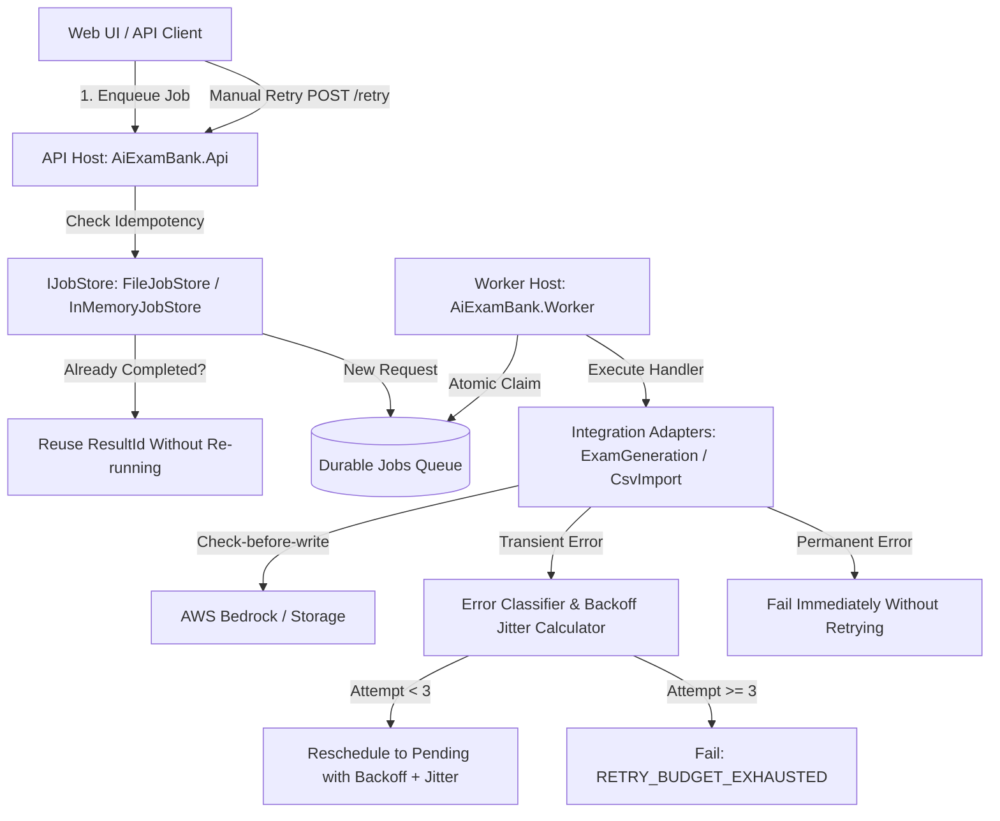

# M5-03 — Retry, Idempotency & Integration Adapters Technical Design

**Owner / Role:** Tran Gia Bao (M5 / @TranGiaBao2005) — Reliability & ML Evaluation Engineer  
**Scope:** MUST · **Priority:** P0 · **Week:** W03  
**Status:** Implemented & Verified in `feat/M5-03-retry-idempotency`  
**Engine Version:** `v1.1.0-rc1`  
**Related Documents:** [M5_02_JOB_ENGINE_DESIGN.md](../M5_02/M5_02_JOB_ENGINE_DESIGN.md), [M5_01_RELIABILITY_DESIGN.md](../M5_01/M5_01_RELIABILITY_DESIGN.md), [DOTNET_SOLUTION_DESIGN.md](../DOTNET_SOLUTION_DESIGN.md).

---

## 1. Mục tiêu và Kiến trúc Tổng quan (Overview & Goal)

Hệ thống **Retry, Idempotency và Integration Adapters (M5-03)** hoàn thiện tầng lõi của Durable Job Engine, đảm bảo tính bền bỉ (*Resilience*), khả năng tự phục hồi khi sự cố mạng hoặc timeout (*Self-healing*), và ngăn ngừa triệt để hiện tượng trùng lặp dữ liệu (*Data Duplication*) khi gọi lại các API sinh đề AI (Bedrock RAG) hoặc Import câu hỏi CSV.



---

## 2. Ma trận Phân loại Lỗi (Failure Taxonomy Matrix)

Lỗi phát sinh trong quá trình thực thi được phân loại nghiêm ngặt thành 3 nhóm độc lập tại `ErrorCategory.cs` & `ErrorClassifier.cs`:

| Nhóm Lỗi (`ErrorCategory`) | Tính chất | Chính sách Thử lại | Các mã lỗi điển hình |
|---|---|---|---|
| **`Transient`** (Tạm thời) | Hạ tầng chập chờn, mạng timeout, rate limit từ nhà cung cấp AI | **Tự động thử lại** theo thuật toán Bounded Exponential Backoff + Jitter (tối đa 3 lần). | `BEDROCK_TIMEOUT`, `BEDROCK_THROTTLED`, `PROVIDER_TIMEOUT`, `NETWORK_UNAVAILABLE`, `CONCURRENCY_CONFLICT`, `SOCKET_ERROR`, `HTTP_429`, `HTTP_503`, `LEASE_EXPIRED`, `WORKER_CRASHED`, `UNHANDLED_EXCEPTION`, hoặc hậu tố `_TIMEOUT`, `_THROTTLED`, `_UNAVAILABLE`. |
| **`Permanent`** (Vĩnh viễn) | Dữ liệu đầu vào sai, vi phạm schema, thiếu câu hỏi duyệt, sai phân quyền | **Dừng ngay lập tức** (Fail-fast), không thử lại mù quáng để tránh lãng phí tài nguyên và làm nghẽn queue. | `ROW_VALIDATION_ERROR`, `INVALID_CSV_SCHEMA`, `PAYLOAD_CORRUPTED`, `BLUEPRINT_INSUFFICIENT_QUESTIONS`, `QUESTION_NOT_APPROVED`, `SCOPED_ACCESS_DENIED`, `UNAUTHORIZED_TOKEN`, `IDEMPOTENCY_FINGERPRINT_MISMATCH`. |
| **`Terminal`** (Kết thúc) | Đã cạn hạn mức ngân sách retry hoặc người dùng bấm hủy tác vụ | **Khóa trạng thái cuối cùng**, không tiếp nhận bất kỳ thử lại tự động nào. | `RETRY_BUDGET_EXHAUSTED`, `JOB_CANCELLED`, `JOB_ABORTED`. |

---

## 3. Cấu hình Thử lại với Lùi Lũy thừa & Jitter (Bounded Exponential Backoff with Jitter)

Triển khai tại `BackoffJitterCalculator.cs` theo chuẩn kiến trúc độ tin cậy AWS (AWS Architecture Best Practices for Retries and Jitter):

### Tham số Cấu hình:
- **`DefaultBaseDelay`**: `30 giây` (khoảng chờ cơ sở ban đầu).
- **`DefaultMaxDelay`**: `15 phút` (trần tối đa cho một lần chờ).
- **`DefaultMaxAttempts`**: `3 lần` (ngân sách chạy tự động tối đa trước khi đánh dấu thất bại vĩnh viễn).
- **Biên độ Jitter**: $\pm 20\%$ (hệ số ngẫu nhiên từ $0.8$ đến $1.2$).

### Công thức Tính toán:
$$\text{RawDelay} = \min\left(\text{MaxDelay}, \text{BaseDelay} \times 2^{(\text{attempt} - 1)}\right)$$
$$\text{FinalDelay} = \min\left(\text{MaxDelay}, \text{RawDelay} \times \text{JitterFactor}\right) \quad \text{với } \text{JitterFactor} \in [0.8, 1.2]$$
$$\text{AvailableAt} = \text{UtcNow} + \text{FinalDelay}$$

- **Lần 1:** $30\text{s} \times 1 \times [0.8, 1.2] = 24\text{s} \dots 36\text{s}$.
- **Lần 2:** $30\text{s} \times 2 \times [0.8, 1.2] = 48\text{s} \dots 72\text{s}$.
- **Lần 3:** Chạm trần 3 lần $\rightarrow$ Chuyển trạng thái `Failed` với mã lỗi `RETRY_BUDGET_EXHAUSTED`.

---

## 4. Đặc tả Kho Chống Trùng lặp & Tái Sử dụng Kết quả (Idempotency Store & Result Reuse)

### Định danh Khóa Duy nhất (Idempotency Key):
Khóa Idempotency được cô lập tuyệt đối theo phạm vi người dùng và trường học:
$$\text{StoreKey} = \text{ScopeKind} : \text{ScopeResourceId} : \text{RequesterId} : \text{JobType} : \text{ClientKey}$$

### Cơ chế Tái sử dụng Kết quả (Result Reuse):
1. **Request Trùng Lặp khi Job Đang Xử Lý (`Pending` hoặc `Running`):**
   - Trả về tham chiếu Job hiện tại mà không tạo bản ghi mới.
2. **Request Trùng Lặp khi Job Đã Thành Công (`Completed`):**
   - Trả về nguyên vẹn bản ghi Job đã hoàn thành kèm `ResultId` sinh ra trước đó.
   - Không đưa vào hàng đợi, không kích hoạt Worker chạy lại.
3. **Phát hiện Bất nhất Tham số (Fingerprint Mismatch):**
   - Nếu cùng khóa Idempotency nhưng Payload hoặc Scope bị thay đổi, hệ thống ném ngoại lệ `JobConflictException` (HTTP 409) với mã lỗi `IDEMPOTENCY_FINGERPRINT_MISMATCH`.

---

## 5. Cơ chế Phục hồi Timeout-after-write cho Integration Adapters

Hai bộ xử lý tích hợp chính gồm `ExamGenerationJobHandler` và `CsvImportJobHandler` áp dụng kỹ thuật **Check-before-write**:

```text
[Bắt đầu Attempt N > 1]
       │
       ▼
Kiểm tra tài nguyên mục tiêu đã tồn tại chưa?
(Snapshot đề thi / Batch import câu hỏi)
       │
 ┌─────┴─────┐
 │           │
[Đã có]   [Chưa có]
 │           │
 │           ▼
 │     Thực thi gọi Bedrock / Ghi DB
 │           │
 └─────┬─────┘
       ▼
Trả về ResultId thành công (Tránh tạo 2 đề thi trùng lặp)
```

- **`ExamGenerationJobHandler`:** Khi phát hiện snapshot đề thi đã được khởi tạo từ attempt trước nhưng worker bị mất kết nối mạng (timeout) trước khi kịp báo Complete, handler ở attempt 2 nhận diện snapshot ID và trả về kết quả thành công ngay lập tức.
- **`CsvImportJobHandler`:** Kiểm tra khóa idempotency của lô câu hỏi đã được chèn vào ngân hàng đề chưa. Nếu đã chèn đủ, bỏ qua bước INSERT và trả về mã batch thành công.

---

## 6. Hợp đồng API RESTful (API Contracts)

### 6.1 Yêu cầu Thử lại Tác vụ (Manual Retry)
- **Endpoint:** `POST /api/v1/jobs/{id}/retry`
- **Headers bắt buộc:** `Authorization: Bearer <token>`, `X-Scope-Id: <scope-id>`
- **Request Body (JSON):**
```json
{
  "reason": "Thử lại sau khi đã sửa dữ liệu nguồn"
}
```
- **Responses:**
  - `200 OK`: Trả về `JobStatusResponse` với trạng thái `Pending`, `AttemptCount = 0`, sẵn sàng cho worker claim.
  - `400 Bad Request`: Job đã hoàn thành (`Completed`), không được phép thử lại.
  - `403 Forbidden`: Người yêu cầu không thuộc phạm vi trường/Bộ sở hữu job.
  - `404 Not Found`: Không tìm thấy mã job.
  - `409 Conflict`: Job đang trong trạng thái `Running` hoặc `Pending`.

### 6.2 Tra cứu Lịch sử các Lượt Thực thi (Attempts History)
- **Endpoint:** `GET /api/v1/jobs/{id}/attempts`
- **Headers bắt buộc:** `Authorization: Bearer <token>`, `X-Scope-Id: <scope-id>`
- **Response (200 OK):**
```json
[
  {
    "attemptNumber": 1,
    "status": "Failed",
    "workerId": "worker-aws-az1",
    "startedAt": "2026-10-22T13:00:00Z",
    "heartbeatAt": "2026-10-22T13:00:30Z",
    "finishedAt": "2026-10-22T13:01:05Z",
    "executionDurationMs": 65000,
    "errorCode": "BEDROCK_TIMEOUT",
    "safeErrorMessage": "AWS Bedrock invocation timed out.",
    "retryReason": null,
    "isManualRetry": false
  },
  {
    "attemptNumber": 2,
    "status": "Completed",
    "workerId": "worker-aws-az2",
    "startedAt": "2026-10-22T13:02:00Z",
    "heartbeatAt": "2026-10-22T13:02:30Z",
    "finishedAt": "2026-10-22T13:02:45Z",
    "executionDurationMs": 45000,
    "errorCode": null,
    "safeErrorMessage": null,
    "retryReason": null,
    "isManualRetry": false
  }
]
```

### 6.3 Đặc tả OpenAPI 3.0 (OpenAPI Contract Snippet)

```yaml
openapi: 3.0.3
info:
  title: AI Exam Bank Background Jobs API
  version: 1.1.0-rc1
paths:
  /api/v1/jobs/{id}/retry:
    post:
      summary: Retry a failed or cancelled background job within authorized scope
      parameters:
        - name: id
          in: path
          required: true
          schema:
            type: string
            format: uuid
        - name: X-Scope-Id
          in: header
          required: true
          schema:
            type: string
            example: school-hn-01
      requestBody:
        required: false
        content:
          application/json:
            schema:
              type: object
              properties:
                reason:
                  type: string
                  example: Manual retry after transient outage
      responses:
        '200':
          description: Job successfully reset to Pending for execution
        '400':
          description: Job already completed; manual retry not permitted
        '403':
          description: Cross-scope retry attempt rejected
        '404':
          description: Job ID not found
        '409':
          description: Job is currently active (Running or Pending)

  /api/v1/jobs/{id}/attempts:
    get:
      summary: Retrieve chronological execution attempts history for a job
      parameters:
        - name: id
          in: path
          required: true
          schema:
            type: string
            format: uuid
        - name: X-Scope-Id
          in: header
          required: true
          schema:
            type: string
      responses:
        '200':
          description: List of execution attempts
        '403':
          description: Forbidden; caller does not own the job scope
        '404':
          description: Job ID not found
```

---

### 6.4 Sổ tay Vận hành Xử lý Sự cố (Operator Runbook)

| Tình huống Sự cố | Triệu chứng & Mã lỗi | Nguyên nhân gốc rễ (RCA) | Hành động Khắc phục (Resolution Steps) |
|---|---|---|---|
| **Cạn ngân sách Retry tự động** | Status `Failed`, ErrorCode `RETRY_BUDGET_EXHAUSTED` | Lỗi mạng hoặc Bedrock timeout liên tục qua 3 lượt chạy tự động (30s, 60s, 120s). | 1. Kiểm tra CloudWatch Logs tìm W3C `CorrelationId` của Job.<br>2. Kiểm tra AWS Bedrock Service Quotas & Throttling.<br>3. Khi hạ tầng ổn định, vào Status UI (`/jobs/`) bấm **[🔄 Thử lại]** hoặc gọi `POST /api/v1/jobs/{id}/retry`. |
| **Lỗi Dữ liệu Nghiệp vụ (Permanent)** | Status `Failed`, ErrorCode `ROW_VALIDATION_ERROR` hoặc `INVALID_CSV_SCHEMA` | File CSV nguồn sai cấu trúc, thiếu cột bắt buộc, hoặc điểm câu hỏi không hợp lệ. | 1. Không thử lại tự động (hệ thống cố tình dừng ngay để tránh lãng phí compute).<br>2. Xem SafeErrorMessage đã redact trên UI để biết dòng bị lỗi.<br>3. Giáo viên cập nhật lại file CSV chuẩn rồi kích hoạt thử lại. |
| **Worker Crash & Treo Lease** | Status `Running` quá thời gian `LeaseExpiresAt` (>2 phút) | Tiến trình Worker EC2 bị OOM, shutdown đột ngột hoặc mất kết nối mạng. | 1. Hệ thống tự động kích hoạt lease recovery: chuyển attempt cũ sang `Abandoned`, đưa job về `Pending` kèm cooldown 1 phút.<br>2. Một worker khác còn sống sẽ tự động claim lại job ở attempt kế tiếp. |

---

### 6.5 Quản lý Phiên bản & Bảo vệ Dữ liệu Nhạy cảm (Redacted Evidence & Release Versioning)

- **Release Version:** `v1.1.0-rc1` (Week W03 Milestone)
- **Engine Source Module:** `Backend/Modules/Jobs/` (.NET 10 Modular Monolith)
- **Job Protocol Version:** `v1` (Base URL: `/api/v1/jobs`)
- **Chính sách Lọc Dữ liệu (PII & Secret Redaction Policy):**
  - Mọi trường `SafeErrorMessage` hiển thị trên UI và trả về qua API tuyệt đối **không chứa**:
    1. Thông tin định danh cá nhân (PII: họ tên, email, CCCD học sinh/giáo viên).
    2. Đề thi thô, câu hỏi gốc hoặc đáp án bài kiểm tra (chỉ dùng `ResultId` hoặc `PayloadReference` S3 URI có phân quyền).
    3. AWS Secret Access Keys, Session Tokens, hoặc Internal Stack Trace từ runtime .NET.

---

## 7. Bằng chứng Kiểm thử & Xác thực (Validation Evidence Matrix)

Toàn bộ các kịch bản nghiệm thu của Issue #15 đã được kiểm thử tự động đạt tỷ lệ thành công 100%:

| Kịch bản Kiểm thử | File Test | Kết quả | Ghi chú |
|---|---|---|---|
| **Duplicate Request & Result Reuse** | `RetryAndIdempotencyTests.cs` | **PASSED** | Gửi cùng idempotency key khi job đã hoàn thành $\rightarrow$ Trả về job cũ và cùng `ResultId`, không enqueue job thừa. |
| **Expired Lease & Recovery Cooldown** | `JobEngineExecutionTests.cs` | **PASSED** | Worker crash $\rightarrow$ Lease quá hạn $\rightarrow$ Chuyển attempt sang `Abandoned`, đưa job về `Pending` với cooldown làm nguội. |
| **Retry Non-retryable (Permanent) Error** | `RetryAndIdempotencyTests.cs` | **PASSED** | Lỗi `ROW_VALIDATION_ERROR` $\rightarrow$ Chuyển sang `Failed` ngay lập tức, không retry tự động. |
| **Timeout Sau Write (Check-before-write)** | `RetryAndIdempotencyTests.cs` | **PASSED** | `ExamGeneration` và `CsvImport` thử lại lần 2 phát hiện kết quả đã ghi $\rightarrow$ Tái sử dụng ID, không sinh đề thi trùng. |
| **Worker Race & Concurrency Conflict** | `JobEngineExecutionTests.cs` | **PASSED** | Nhiều worker claim đồng thời $\rightarrow$ Windows Named Mutex / Fencing Token đảm bảo chỉ đúng 1 worker claim thành công. |
| **Zero-Trust Scoped Authorization** | `RetryAndIdempotencyTests.cs` | **PASSED** | Gọi retry hoặc xem attempts chéo trường (`School A` sang `School B`) $\rightarrow$ Bị chặn `403 Forbidden`. |
| **Repo Hygiene & File Integrity** | `check_repository.py` | **PASSED** | 412 files checked, 0 errors, 0 warnings. |
| **API Smoke & Liveness Suite** | `test_api_health.py` | **PASSED** | Vượt qua 100% các bài test liveness, token forgery, dev-token protection. |

---

## 8. Bảng Đối chiếu Tiêu chí Nghiệm thu (Acceptance Criteria Checklist)

- [x] **Không nhân đôi kết quả nghiệp vụ:** Retry import/generation không tạo trùng câu hỏi hoặc đề thi; duplicate call cùng key trả về đúng job cũ.
- [x] **Bảo toàn bất biến phân quyền:** Không rò rỉ dữ liệu giữa các trường; mọi endpoint tra cứu và thử lại đều xác thực `JobScope`.
- [x] **Không có Secret bị lộ:** Dữ liệu lỗi được redact an toàn, PII và đề thi gốc không xuất hiện trong thông báo lỗi.
- [x] **Tương thích CI/CD:** Solution biên dịch với 0 cảnh báo, 0 lỗi; `global.json` ghim chuẩn `10.0.400` cho runner GitHub Actions.
