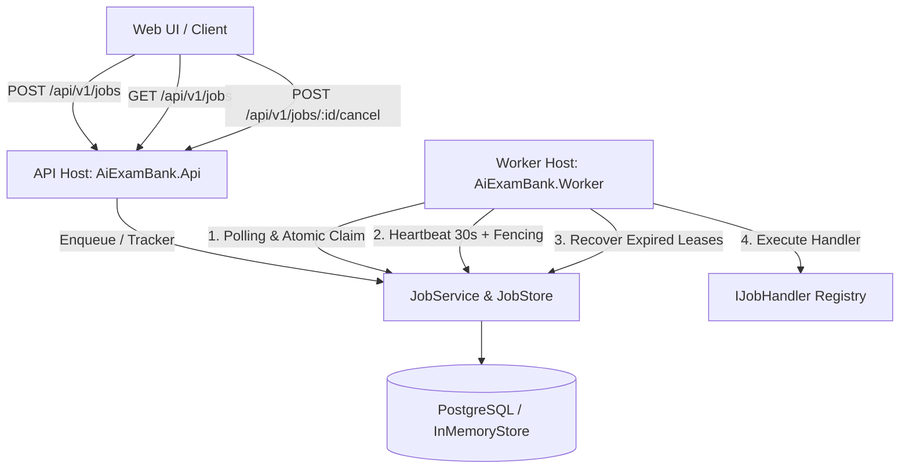

# M5-02 — Durable Background Job Engine & Status UI Technical Design

**Owner:** Tran Gia Bao (M5 / @TranGiaBao2005)  
**Status:** Implemented & Verified in `feat/M5-02-durable-job-engine`  
**Engine Version:** `v1.0.0-rc1`  
**DDL Migration:** `src/Persistence/Migrations/001_create_jobs_and_job_attempts.sql`  
**Related Documents:** [M5_01_RELIABILITY_DESIGN.md](../M5_01/M5_01_RELIABILITY_DESIGN.md), [DOTNET_SOLUTION_DESIGN.md](../DOTNET_SOLUTION_DESIGN.md), [IMPLEMENTATION_PLAN.md](../IMPLEMENTATION_PLAN.md).

---

## 1. Mục tiêu và Kiến trúc Tổng thể (Overview & Architecture)

Hệ thống **Durable Job Engine** (M5-02) chịu trách nhiệm thực thi các tác vụ ngầm chạy lâu (như sinh đề thi AI qua Bedrock, nhập danh sách câu hỏi CSV, đồng bộ vector embeddings) một cách bền vững, có khả năng phục hồi khi lỗi, ngăn chặn trùng lặp và bảo vệ tính nhất quán dữ liệu trong môi trường phân tán nhiều trường học và kỳ thi cấp Bộ.



---

## 2. Máy Trạng Thái Tác Vụ (Job State Machine Diagram)

Toàn bộ vòng đời của một Background Job được quản lý chặt chẽ theo biểu đồ trạng thái sau:

```mermaid
stateDiagram-v2
    [*] --> Pending: EnqueueAsync (Idempotent)

    Pending --> Running: Worker Claims Lease (Atomic)
    Pending --> Cancelled: RequestCancellationAsync (Immediate)

    Running --> Running: Heartbeat 30s (Extend Lease +2m)
    Running --> Completed: Handler Returns Success (CompleteJobAsync Blocked If Cancelled)

    Running --> Pending: Transient Failure & Attempt < 3 (Backoff +1m / +5m)
    Running --> Failed: Non-transient Failure (Preserves Handler ErrorCode) OR Attempt >= 3 (RETRY_BUDGET_EXHAUSTED)

    Running --> Cancelled: RequestCancellationAsync (Marks Cancelled Immediately; Signals CancellationToken)

    Running --> Pending: Worker Crash & Lease Expired (>2m) & Attempt < 3 (Recover with Backoff)
    Running --> Failed: Worker Crash & Lease Expired (>2m) & Attempt >= 3 (RETRY_BUDGET_EXHAUSTED)

    Completed --> [*]
    Failed --> [*]
    Cancelled --> [*]
```



### Chi tiết chuyển trạng thái & Giới hạn thử lại (Bounded Retries):

1. **Pending**: Tác vụ đã được tiếp nhận, đang chờ Worker thăm dò.
2. **Running**: Worker đã chiếm được `LeaseToken` ngẫu nhiên.
3. **Heartbeat & Lease**: Lease có hiệu lực **2 phút**. Worker gửi nhịp tim mỗi **30 giây** để gia hạn thêm 2 phút.
4. **Cơ chế Bounded Retries & Thất bại**:
    - Thất bại lần 1 (Transient error): `AttemptCount = 1` $\rightarrow$ Hẹn giờ chạy lại sau **1 phút** (`AvailableAt = UtcNow + 1m`), quay về `Pending`.
    - Thất bại lần 2 (Transient error): `AttemptCount = 2` $\rightarrow$ Hẹn giờ chạy lại sau **5 phút** (`AvailableAt = UtcNow + 5m`), quay về `Pending`.
    - Thất bại lần 3 (Transient error vượt ngân sách): Chuyển sang `Failed` với mã lỗi `RETRY_BUDGET_EXHAUSTED`.
    - Gặp lỗi nghiệp vụ cố định (Non-transient): Chuyển thẳng sang `Failed`, giữ nguyên `ErrorCode` do Handler trả về (không bị ghi đè thành `RETRY_BUDGET_EXHAUSTED`).
5. **Hủy an toàn (Cancellation & Fencing)**:
    - Khi `RequestCancellationAsync` được gọi, trạng thái tác vụ chuyển sang `Cancelled` ngay lập tức trong Store (`CancellationRequestedAt` được ghi nhận) và phát tín hiệu tới `CancellationToken` của Worker.
    - Khi một tác vụ đã ở trạng thái `Cancelled` hoặc đã có yêu cầu hủy, `CompleteJobAsync` sẽ bị từ chối (trả về `false`) để ngăn chặn việc ghi nhận hoàn tất sau khi đã hủy.
6. **Cơ chế Fencing & Cửa sổ Recovery**:
    - Store thực hiện fencing dựa trên `LeaseToken` và trạng thái `AttemptStatus.Started` của lượt thử hiện tại.
    - Trong khoảng thời gian sau khi lease hết hạn nhưng `RecoverExpiredLeasesAsync` (hoặc luồng claim mới) chưa chạy, lượt thử vẫn giữ trạng thái `Started`, do đó các thao tác commit kết quả (`CompleteJobAsync`), cập nhật tiến độ (`UpdateProgressAsync`), hoặc nhịp tim (`HeartbeatAsync`) từ worker cũ vẫn được chấp nhận thành công.
    - Ngay khi quá trình recovery chạy và đánh dấu attempt cũ là `Abandoned` (hoặc worker khác claim thành công với lease token mới), token cũ lập tức bị fencing từ chối hoàn toàn.

---

## 3. Worker Contract & Example Handlers

### 3.1. Hợp đồng Worker (`IJobHandler`)

Mọi tác vụ xử lý nền đều phải hiện thực giao diện [IJobHandler.cs](../../src/Modules/Jobs/Contracts/IJobHandler.cs):

```csharp
public interface IJobHandler
{
    string JobType { get; }
    Task<JobExecutionResult> ExecuteAsync(
        JobExecutionContext context,
        CancellationToken cancellationToken);
}
```

- **`JobExecutionContext`**: Cung cấp mã `JobId`, thông tin `JobRequest`, số lần thử `AttemptNumber`, và delegate `ReportProgressAsync(int percentage)` để cập nhật tiến độ về UI.
- **`JobExecutionResult`**: Kết quả đầu ra an toàn gồm cờ `Succeeded`, `ResultId`, `ErrorCode`, `SafeErrorMessage`, và cờ `IsTransient` (chỉ định có được retry hay không).

### 3.2. Đăng ký Handler (`IJobRegistry` & `JobRegistry`)

Quản lý tập trung các Handler dưới dạng Thread-safe Dictionary:

- `Register(IJobHandler handler)`
- `GetHandler(string jobType)` / `HasHandler(string jobType)`

### 3.3. Các Handler mẫu (Example Handlers)

1. **[SampleJobHandler.cs](../../src/Modules/Jobs/Infrastructure/SampleJobHandler.cs)** (`JobType = "SampleJob"`):
    - Mô phỏng quy trình 4 chặng: Khởi tạo (25%) $\rightarrow$ Xử lý dữ liệu (50%) $\rightarrow$ Tổng hợp (75%) $\rightarrow$ Hoàn tất (100%).
    - Kiểm tra `cancellationToken.ThrowIfCancellationRequested()` giữa các chặng để phản hồi lập tức khi người dùng bấm Hủy.
2. **[ExamGenerationJobHandler.cs](../../src/Modules/Jobs/Infrastructure/ExamGenerationJobHandler.cs)** (`JobType = "ExamGeneration"` - Module M1):
    - Mô phỏng tác vụ sinh đề thi AI qua Bedrock: Đọc ma trận đề (20%) $\rightarrow$ Sinh câu hỏi AI (50%) $\rightarrow$ Thẩm định độ khó (80%) $\rightarrow$ Đóng gói bản snapshot đề thi (100%).
3. **[CsvImportJobHandler.cs](../../src/Modules/Jobs/Infrastructure/CsvImportJobHandler.cs)** (`JobType = "CsvImport"` - Module M2):
    - Mô phỏng tác vụ đọc file CSV/Excel câu hỏi lớn: Tải tệp từ S3 raw (25%) $\rightarrow$ Phân tích cấu trúc hàng (50%) $\rightarrow$ Kiểm định trùng lặp (75%) $\rightarrow$ Ghi vào ngân hàng câu hỏi (100%).

---

## 4. Khóa Idempotency & Bảo Mật Phân Quyền (Security & Scoping)

### 4.1. Khóa chống trùng lặp Idempotency

- Khóa duy nhất (Idempotency Uniqueness Key):
  $$\text{Key} = (\text{Scope.Kind}, \text{Scope.ResourceId}, \text{CreatedBy}, \text{JobType}, \text{IdempotencyKey})$$
- Cùng bộ khóa + cùng `RequestFingerprint` (SHA-256): Trả về kết quả Job hiện hữu (`Idempotent Return`).
- Cùng bộ khóa + khác `RequestFingerprint`: Ném ngoại lệ `JobConflictException` $\rightarrow$ API phản hồi HTTP **409 Conflict** (`IDEMPOTENCY_CONFLICT`).

### 4.2. Phân quyền theo phạm vi trường học và kiểm soát chủ sở hữu (Scoped Authorization & Ownership Enforcement)

- **Cô lập phạm vi trường học (Scope Fencing):** Mọi truy vấn và thao tác (`GET /api/v1/jobs/{id}`, danh sách, hủy job) đều bắt buộc đối chiếu người gửi yêu cầu với phạm vi trường học (`School`) hoặc kỳ thi Bộ (`MinistryExam`). Cấm tuyệt đối truy cập chéo trường: Người dùng từ `school-1` truy vấn job của `school-2` sẽ nhận mã lỗi HTTP **403 Forbidden** (`SCOPED_ACCESS_DENIED`).
- **Kiểm soát quyền sở hữu tác vụ (Ownership Enforcement):** Trong cùng một phạm vi trường học, chỉ chủ sở hữu (`job.CreatedBy == requesterId`) hoặc admin được ủy quyền mới được phép đọc chi tiết (`GetJobStatusAsync`), hủy (`CancelJobAsync`) và liệt kê (`ListJobsAsync`) tác vụ của mình. Người dùng khác trong cùng trường học khi truy cập tác vụ của người khác sẽ bị từ chối với HTTP **403 Forbidden** và không thể xem job trong danh sách.
- **Log Redaction:** Tuyệt đối không để lộ payload thô, đề thi, đáp án hoặc thông tin định danh cá nhân (PII) trong log và status DTO.

---

## 5. OpenAPI & HTTP API Contracts (`src/Api`)

Hệ thống tuân thủ nghiêm ngặt chuẩn **RFC 7807 Problem Details** cho mọi trường hợp lỗi.

### 5.1. Danh mục Endpoints

| Phương thức | Đường dẫn                  | Headers / Tham số                                                                                                                                                                                                               | Phản hồi chuẩn                                                                          | Mã lỗi có thể gặp                                                                                        | Mô tả                                          |
| ----------- | -------------------------- | ------------------------------------------------------------------------------------------------------------------------------------------------------------------------------------------------------------------------------- | --------------------------------------------------------------------------------------- | -------------------------------------------------------------------------------------------------------- | ---------------------------------------------- |
| `POST`      | `/api/v1/jobs`             | Header: `Authorization: Bearer <token>` (giải quyết danh tính và scope qua `ResolveAuthenticatedScope`), `X-Correlation-Id` (tùy chọn)<br>Body: `jobType`, `payloadReference`, `scopeKind`, `scopeResourceId`, `idempotencyKey` | **202 Accepted**<br>`{ jobId, status: "Pending", correlationId }`                       | 400 (Validation)<br>401 (Unauthorized)<br>403 (Cross-scope)<br>409 (`IDEMPOTENCY_CONFLICT`)              | Đưa tác vụ vào hàng đợi an toàn                |
| `GET`       | `/api/v1/jobs/{id}`        | Path: `id`<br>Header: `Authorization: Bearer <token>`                                                                                                                                                                           | **200 OK**<br>`{ jobId, jobType, status, progressPercentage, resultId, errorCode, safeMessage }` | 401 (Unauthorized)<br>403 (`SCOPED_ACCESS_DENIED`)<br>404 (`Job Not Found`)                              | Lấy trạng thái an toàn của tác vụ              |
| `GET`       | `/api/v1/jobs`             | Query: `scopeKind`, `scopeResourceId`, `status` (tùy chọn)<br>Header: `Authorization: Bearer <token>`                                                                                                                           | **200 OK**<br>`[ { jobId, jobType, status, ... } ]`                                              | 400 (`Invalid Scope Kind`)<br>401 (Unauthorized)<br>403 (`SCOPED_ACCESS_DENIED`)                         | Lọc danh sách tác vụ trong phạm vi đã xác thực |
| `POST`      | `/api/v1/jobs/{id}/cancel` | Path: `id`<br>Header: `Authorization: Bearer <token>`                                                                                                                                                                           | **200 OK**<br>`{ success, message }`                                                    | 401 (Unauthorized)<br>403 (`SCOPED_ACCESS_DENIED`)<br>404 (Not Found)<br>409 (`JOB_CANNOT_BE_CANCELLED`) | Yêu cầu hủy tác vụ an toàn                     |

### 5.2. Cấu trúc Lỗi Chuẩn RFC 7807 Problem Details

```json
{
    "type": "https://tools.ietf.org/html/rfc7807",
    "title": "Access Denied",
    "status": 403,
    "detail": "Requester is not authorized to access this job.",
    "code": "SCOPED_ACCESS_DENIED",
    "traceId": "00-5e324ed4992ba8573ba2e90267f765be-759fc475d2f1e472-00"
}
```

---

## 6. Giao Diện Người Dùng Status UI Panel (`src/Api/wwwroot/jobs`)

- **Địa chỉ truy cập:** `http://localhost:5000/jobs/` (hoặc `http://localhost:5000` tự chuyển hướng).
- **Thẩm mỹ Dark Mode Glassmorphism:** Phông chữ Google Fonts Inter, hiệu ứng mờ kính frosted glass, đổ bóng tinh tế.
- **5 Thẻ KPI Thống kê:** Tổng số, Đang chạy, Chờ xử lý, Hoàn thành, Thất bại (nhảy số real-time).
- **Thăm dò thích ứng (Adaptive Polling):**
    - Tần suất **2s** khi có tác vụ đang chạy (`Pending` hoặc `Running`).
    - Tự động giãn cách (**Backoff**) thành **5s** khi hàng đợi nhàn rỗi (toàn bộ tác vụ đã kết thúc).
    - Tự động giãn thành **8s** khi mất kết nối mạng.
    - Tự động dừng hẳn polling (`clearInterval`) khi người dùng chuyển sang tab khác (`document.hidden` via `visibilitychange`) để tiết kiệm CPU và tài nguyên mạng.
- **Interactive Details Drawer:** Trượt từ cạnh phải màn hình hiển thị đầy đủ chi tiết tiến độ, mã lỗi an toàn, mã kết quả mà không làm lộ stack trace nội bộ.
- **Modal Tạo Tác Vụ Mẫu:** Cho phép kiểm thử trực tiếp sinh đề AI hoặc nhập CSV ngay trên trình duyệt.

---

## 7. Cấu Hình Vận Hành & Runbook (Configuration & Operations)

### 7.1. Bảng tham số cấu hình Worker ([JobWorkerOptions.cs](../../src/Worker/JobWorkerOptions.cs))

| Tham số              | Giá trị mặc định       | Mô tả                                                     |
| -------------------- | ---------------------- | --------------------------------------------------------- |
| `WorkerId`           | `worker-{MachineName[..12]}-{Guid:N}`        | Định danh duy nhất của Worker instance kết hợp tên máy và GUID                            |
| `PollingInterval`    | `1 giây`               | Khoảng thời gian cơ sở giữa các lần quét hàng đợi         |
| `MaxPollingInterval` | `5 giây`               | Thời gian giãn cách tối đa khi hàng đợi trống             |
| `HeartbeatInterval`  | `30 giây`              | Chu kỳ gửi nhịp tim gia hạn thời gian chiếm quyền (Lease) |
| `LeaseDuration`      | `2 phút`               | Thời hạn tối đa của một lượt Lease                        |
| `RecoveryInterval`   | `30 giây`              | Chu kỳ quét và thu hồi các Job bị bỏ rơi do Worker crash  |

### 7.2. Runbook Vận hành (Operator Runbook)

Chạy mỗi khối lệnh trong một terminal riêng, bắt đầu từ thư mục gốc repository. Cả hai host phải dùng cùng đường dẫn tuyệt đối `Jobs__StorePath`.

#### 1. Khởi chạy API Host

```powershell
$repoRoot = (Get-Location).Path
$env:Jobs__StorePath = Join-Path $repoRoot "bin/jobs-store.json"
$env:Jobs__DisableEmbeddedWorker = "true"
$env:ASPNETCORE_ENVIRONMENT = "Development"
$env:DOTNET_ENVIRONMENT = "Development"
cd src/Api
dotnet bin/Release/net10.0/AiExamBank.Api.dll --urls "http://localhost:5000"
```

Truy cập giao diện UI tại: `http://localhost:5000/jobs/`.

#### 2. Khởi chạy Worker Host độc lập

```powershell
$repoRoot = (Get-Location).Path
$env:Jobs__StorePath = Join-Path $repoRoot "bin/jobs-store.json"
$env:DOTNET_ENVIRONMENT = "Development"
cd src/Worker
dotnet bin/Release/net10.0/AiExamBank.Worker.dll
```

#### 3. Xử lý sự cố Worker Crash đột ngột

- Nếu một Worker bị ngắt điện hoặc crash giữa chừng, tác vụ sẽ giữ trạng thái `Running` nhưng `Heartbeat` dừng hoạt động.
- Sau đúng **2 phút** (`LeaseDuration`), các Worker khác đang chạy sẽ tự động kích hoạt tiến trình `RecoverExpiredLeasesAsync`.
- Tác vụ sẽ tự động được phục hồi: nếu chưa hết 3 lần thử, tác vụ chuyển về `Pending` để chạy lại; nếu đã hết 3 lần thử, tác vụ chuyển sang `Failed` với mã lỗi `RETRY_BUDGET_EXHAUSTED`.

---

## 8. Báo Cáo Kiểm Thử Tự Động (Test Report & Evidence)

Tất cả 33 bài kiểm thử chuyên sâu trong [JobEngineExecutionTests.cs](../../tests/Modules/Jobs.Tests/JobEngineExecutionTests.cs) (cùng 3 bài kiểm thử [JobContractTests.cs](../../tests/Modules/Jobs.Tests/JobContractTests.cs)) đều **PASSED 100%**:

| STT | Tên Test Case                                                                                         | Mục đích kiểm thử                                                                                                                      | Kết quả |
| :-: | ----------------------------------------------------------------------------------------------------- | -------------------------------------------------------------------------------------------------------------------------------------- | :-----: |
|  1  | `Enqueue_returns_same_job_on_identical_fingerprint`                                                   | Kiểm tra tính bất biến Idempotency khi gửi trùng lặp cùng Fingerprint                                                                  | ✅ PASS |
|  2  | `Enqueue_throws_conflict_on_mismatched_fingerprint`                                                   | Kiểm tra phát hiện xung đột khi cùng IdempotencyKey nhưng khác Fingerprint                                                             | ✅ PASS |
|  3  | `Competing_workers_only_one_claims_job`                                                               | Kiểm tra chống tranh chấp (Race Condition): 2 Worker tranh nhau claim 1 Job                                                            | ✅ PASS |
|  4  | `Heartbeat_renews_for_active_lease_and_fences_stale_tokens`                                           | Kiểm tra Worker gửi nhịp tim định kỳ gia hạn thành công thời hạn Lease và rào token cũ                                                 | ✅ PASS |
|  5  | `Fencing_prevents_stale_worker_from_completing_job`                                                   | Kiểm tra hàng rào Fencing chặn đứng Worker cũ có token hết hạn hoàn tất job                                                            | ✅ PASS |
|  6  | `Transient_failure_schedules_bounded_retries_and_exhausts_at_attempt_3`                               | Kiểm tra Bounded Retries: Lỗi tạm thời tự động lên lịch chạy lại sau 1m/5m và cạn kiệt ở lần 3                                         | ✅ PASS |
|  7  | `Cancellation_marks_pending_job_cancelled_immediately`                                                | Kiểm tra hủy tác vụ đang ở hàng đợi Pending chuyển ngay sang Cancelled                                                                 | ✅ PASS |
|  8  | `Stale_lease_recovery_reclaims_abandoned_job`                                                         | Kiểm tra tự động thu hồi Job bị bỏ hoang khi Worker trước bị crash quá 2 phút                                                          | ✅ PASS |
|  9  | `Job_service_enqueue_and_tracker_list_respects_scope`                                                 | Kiểm tra lọc danh sách công việc đúng theo phạm vi trường học                                                                          | ✅ PASS |
| 10  | `Worker_service_executes_sample_handler_to_completion`                                                | Kiểm tra vòng lặp Worker Service thực thi trọn vẹn tác vụ mẫu đến thành công                                                           | ✅ PASS |
| 11  | `Cross_school_read_is_denied_with_unauthorized_access_exception`                                      | Kiểm tra bảo mật từ chối truy cập chéo trường học (HTTP 403)                                                                           | ✅ PASS |
| 12  | `Missing_scope_on_read_or_cancel_or_list_throws_unauthorized_access_exception`                        | Kiểm tra bắt buộc truyền scope trên read, cancel, list                                                                                 | ✅ PASS |
| 13  | `Cross_scope_kind_access_with_matching_resource_id_is_rejected`                                       | Kiểm tra bảo mật từ chối truy cập chéo loại scope (School vs MinistryExam)                                                             | ✅ PASS |
| 14  | `Case_insensitive_resource_id_in_store_list_returns_matching_jobs`                                    | Kiểm tra tra cứu danh sách job không phân biệt hoa thường theo ResourceId                                                              | ✅ PASS |
| 15  | `Case_insensitive_resource_id_creates_same_idempotency_and_fingerprint`                               | Kiểm tra chuẩn hóa ToUpperInvariant tạo cùng khóa idempotency và fingerprint                                                           | ✅ PASS |
| 16  | `Commit_with_expired_lease_succeeds_before_recovery_and_fences_after_recovery`                        | Lease quá hạn vẫn cho commit trước khi recovery chạy; sau recovery, token cũ bị fencing                                                | ✅ PASS |
| 16b | `FileJobStore_commit_with_expired_lease_succeeds_before_recovery_and_fences_after_recovery`           | Hành vi tương tự cho FileJobStore                                                                                                      | ✅ PASS |
| 17  | `FileJobStore_preserves_queued_jobs_across_restart_and_instances`                                     | Kiểm tra tính bền vững của FileJobStore qua các lần khởi động lại                                                                      | ✅ PASS |
| 18  | `Exam_generation_and_csv_import_handlers_are_registered_and_executable`                               | Kiểm tra đăng ký và thực thi handler sinh đề thi AI và import CSV                                                                      | ✅ PASS |
| 19  | `Job_scope_create_throws_argument_exception_on_whitespace_or_undefined_enum`                          | Kiểm tra validate enum và resourceId không được là khoảng trắng                                                                        | ✅ PASS |
| 20  | `Job_service_list_cross_school_throws_unauthorized_access_exception`                                  | Kiểm tra từ chối liệt kê job chéo trường học                                                                                           | ✅ PASS |
| 21  | `Legacy_snapshot_is_migrated_and_preserves_idempotency_via_job_service`                               | Kiểm tra di trú tự động snapshot SchemaVersion 1 sang SchemaVersion 2 bảo toàn Idempotency                                             | ✅ PASS |
| 22  | `Postgres_migration_script_enforces_case_insensitive_unique_idempotency_index_and_scope_index`        | Kiểm tra migration PostgreSQL áp dụng UPPER(scope_resource_id) cho unique index và scope index                                         | ✅ PASS |
| 23  | `Legacy_handler_overload_is_invoked_and_returns_success_through_default_interface_implementation`     | Kiểm tra tính tương thích ngược của IJobHandler cho handler chỉ triển khai overload cũ                                                 | ✅ PASS |
| 24  | `Worker_commits_job_as_completed_even_when_host_token_is_cancelled_immediately_after_handler_success` | Kiểm tra tính bền vững của Worker khi Host shutdown ngay sau khi Handler hoàn tất                                                      | ✅ PASS |
| 25  | `FileJobStore_claim_on_expired_lease_applies_backoff_cooldown`                                        | Kiểm tra claim lease quá hạn áp dụng cooldown 1m/5m, không retry dồn dập                                                               | ✅ PASS |
| 26  | `Handler_without_overrides_fails_and_does_not_report_completed`                                       | Kiểm tra handler rỗng ném NotImplementedException và ghi nhận lỗi hệ thống                                                             | ✅ PASS |
| 27  | `TaskCanceledException_when_job_token_not_cancelled_fails_as_transient`                               | Kiểm tra timeout nội bộ khi token job chưa hủy được ghi nhận lỗi tạm thời                                                              | ✅ PASS |
| 28  | `Worker_fails_job_as_permanent_failure_even_when_host_token_is_cancelled`                             | Kiểm tra lỗi vĩnh viễn ghi nhận Failed với đúng ErrorCode ngay cả khi host dừng                                                        | ✅ PASS |
| 29  | `CancelJobAsync_throws_key_not_found_exception_when_job_does_not_exist`                               | Kiểm tra hủy job không tồn tại ném KeyNotFoundException để API trả về 404                                                              | ✅ PASS |
| 30  | `Worker_id_is_unique_and_preserves_guid_even_with_long_machine_name`                                  | Kiểm tra WorkerId giữ trọn vẹn GUID duy nhất ngay cả khi tên máy (EC2 hostname) dài                                                    | ✅ PASS |
| 31  | `Cancellation_watcher_cancels_running_job_when_handler_does_not_report_progress`                      | Kiểm tra Cancellation Watcher ngắt ngay job đang chạy khi bị hủy mà không cần đợi heartbeat 30s                                        | ✅ PASS |
| 32  | `Cancellation_watcher_survives_transient_read_fault_and_propagates_cancellation`                      | Kiểm tra Watcher không bị chết khi gặp lỗi đọc tạm thời và truyền tín hiệu hủy thành công                                              | ✅ PASS |
| 33  | `Heartbeat_kept_alive_during_terminal_write_prevents_lease_expiration_and_duplicate_execution`        | Kiểm tra duy trì heartbeat trong lúc ghi terminal state khi có tranh chấp lock/mutex, ngăn lease bị hết hạn nhầm và không chạy lại job | ✅ PASS |
| 34  | `Successful_retry_clears_job_errors_and_preserves_attempt_history`                                   | Kiểm tra xóa ErrorCode/SafeErrorMessage khi retry thành công trên cả InMemory và File store                                             | ✅ PASS |
| 35  | `Job_status_and_list_preserve_job_type`                                                               | Kiểm tra giữ nguyên JobType trong GetJobStatus và ListJobs                                                                             | ✅ PASS |
| 36  | `Same_scope_different_user_cannot_read_or_cancel_job`                                                  | Kiểm tra cô lập quyền sở hữu: người dùng khác trong cùng trường không thể đọc, hủy hay liệt kê job của người tạo                        | ✅ PASS |

### Tổng hợp Chất lượng Solution:

- **`dotnet test AiExamBank.slnx`**: **50/50 test executions PASSED** (41 Jobs + 3 Questions + 3 Exams + 3 Architecture).
- **`dotnet build --warnaserror`**: **0 Warnings, 0 Errors** trong cấu hình Release.
- **`python tests/smoke/test_api_health.py`**: **PASSED 100%** (Liveness probe, Zero-Trust authentication, Worker integration và Problem Details RFC 7807 hoạt động hoàn hảo).
- **`python tools/check_repository.py`**: **0 issues** trên toàn bộ files được theo dõi.
- **Redacted Evidence:** Mọi mã ID kiểm thử đều sử dụng UUID giả lập (`00000000-0000-0000-0000-000000000001`, `school-1`), không chứa bất kỳ secret key hay PII nào.
