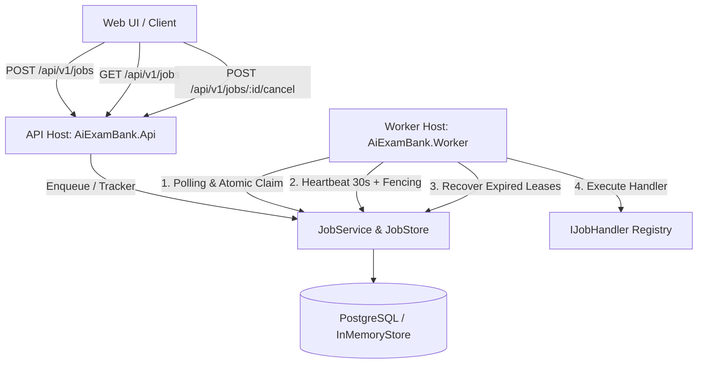
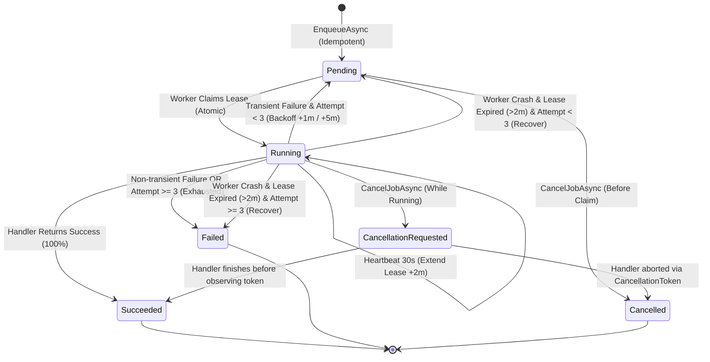

# M5-02 — Durable Background Job Engine & Status UI Technical Design

**Owner:** Tran Gia Bao (M5 / @TranGiaBao2005)  
**Status:** Implemented & Verified in `feat/M5-02-durable-job-engine`  
**Engine Version:** `v1.0.0-rc1`  
**DDL Migration:** `src/Persistence/Migrations/001_create_jobs_and_job_attempts.sql`  
**Related Documents:** [M5_01_RELIABILITY_DESIGN.md](../M5_01/M5_01_RELIABILITY_DESIGN.md), [DOTNET_SOLUTION_DESIGN.md](../DOTNET_SOLUTION_DESIGN.md), [IMPLEMENTATION_PLAN.md](../IMPLEMENTATION_PLAN.md).

---

## 1. Mục tiêu và Kiến trúc Tổng thể (Overview & Architecture)

Hệ thống **Durable Job Engine** (M5-02) chịu trách nhiệm thực thi các tác vụ ngầm chạy lâu (như sinh đề thi AI qua Bedrock, nhập danh sách câu hỏi CSV, đồng bộ vector embeddings) một cách bền vững, có khả năng phục hồi khi lỗi, ngăn chặn trùng lặp và bảo vệ tính nhất quán dữ liệu trong môi trường phân tán nhiều trường học và kỳ thi cấp Bộ.



---

## 2. Máy Trạng Thái Tác Vụ (Job State Machine Diagram)

Toàn bộ vòng đời của một Background Job được quản lý chặt chẽ theo biểu đồ trạng thái sau:



### Chi tiết chuyển trạng thái & Giới hạn thử lại (Bounded Retries):
1. **Pending**: Tác vụ đã được tiếp nhận, đang chờ Worker thăm dò.
2. **Running**: Worker đã chiếm được `LeaseToken` ngẫu nhiên.
3. **Heartbeat & Lease**: Lease có hiệu lực **2 phút**. Worker gửi nhịp tim mỗi **30 giây** để gia hạn thêm 2 phút.
4. **Cơ chế Bounded Retries**:
   - Thất bại lần 1 (Transient error): `AttemptCount = 1` $\rightarrow$ Hẹn giờ chạy lại sau **1 phút** (`AvailableAt = UtcNow + 1m`), quay về `Pending`.
   - Thất bại lần 2 (Transient error): `AttemptCount = 2` $\rightarrow$ Hẹn giờ chạy lại sau **5 phút** (`AvailableAt = UtcNow + 5m`), quay về `Pending`.
   - Thất bại lần 3 (hoặc gặp lỗi nghiệp vụ cố định Non-transient): Chuyển thẳng sang `Failed` với mã lỗi `RETRY_BUDGET_EXHAUSTED`.
5. **Hủy an toàn (Safe Cancellation)**: Tác vụ đang chạy khi bị yêu cầu hủy sẽ được kích hoạt `CancellationToken` liên kết. Handler có cơ hội hoàn tất dọn dẹp tài nguyên trước khi chuyển sang `Cancelled`.

---

## 3. Worker Contract & Example Handlers

### 3.1. Hợp đồng Worker (`IJobHandler`)
Mọi tác vụ xử lý nền đều phải hiện thực giao diện [IJobHandler.cs](../../src/Modules/Jobs/Contracts/IJobHandler.cs):

```csharp
public interface IJobHandler
{
    string JobType { get; }
    Task<JobExecutionResult> ExecuteAsync(
        JobExecutionContext context,
        CancellationToken cancellationToken);
}
```

- **`JobExecutionContext`**: Cung cấp mã `JobId`, thông tin `JobRequest`, số lần thử `AttemptNumber`, và delegate `ReportProgressAsync(int percentage)` để cập nhật tiến độ về UI.
- **`JobExecutionResult`**: Kết quả đầu ra an toàn gồm cờ `Succeeded`, `ResultId`, `ErrorCode`, `SafeErrorMessage`, và cờ `IsTransient` (chỉ định có được retry hay không).

### 3.2. Đăng ký Handler (`IJobRegistry` & `JobRegistry`)
Quản lý tập trung các Handler dưới dạng Thread-safe Dictionary:
- `Register(string jobType, IJobHandler handler)`
- `GetHandler(string jobType)` / `HasHandler(string jobType)`

### 3.3. Các Handler mẫu (Example Handlers)
1. **[SampleJobHandler.cs](../../src/Modules/Jobs/Infrastructure/SampleJobHandler.cs)** (`JobType = "SampleJob"`):
   - Mô phỏng quy trình 4 chặng: Khởi tạo (25%) $\rightarrow$ Xử lý dữ liệu (50%) $\rightarrow$ Tổng hợp (75%) $\rightarrow$ Hoàn tất (100%).
   - Kiểm tra `cancellationToken.ThrowIfCancellationRequested()` giữa các chặng để phản hồi lập tức khi người dùng bấm Hủy.
2. **[ExamGenerationJobHandler.cs](../../src/Modules/Jobs/Infrastructure/ExamGenerationJobHandler.cs)** (`JobType = "ExamGeneration"` - Module M1):
   - Mô phỏng tác vụ sinh đề thi AI qua Bedrock: Đọc ma trận đề (20%) $\rightarrow$ Sinh câu hỏi AI (50%) $\rightarrow$ Thẩm định độ khó (80%) $\rightarrow$ Đóng gói bản snapshot đề thi (100%).
3. **[CsvImportJobHandler.cs](../../src/Modules/Jobs/Infrastructure/CsvImportJobHandler.cs)** (`JobType = "CsvImport"` - Module M2):
   - Mô phỏng tác vụ đọc file CSV/Excel câu hỏi lớn: Tải tệp từ S3 raw (25%) $\rightarrow$ Phân tích cấu trúc hàng (50%) $\rightarrow$ Kiểm định trùng lặp (75%) $\rightarrow$ Ghi vào ngân hàng câu hỏi (100%).

---

## 4. Khóa Idempotency & Bảo Mật Phân Quyền (Security & Scoping)

### 4.1. Khóa chống trùng lặp Idempotency
- Khóa duy nhất (Idempotency Uniqueness Key):
  $$\text{Key} = (\text{Scope.Kind}, \text{Scope.ResourceId}, \text{CreatedBy}, \text{JobType}, \text{IdempotencyKey})$$
- Cùng bộ khóa + cùng `RequestFingerprint` (SHA-256): Trả về kết quả Job hiện hữu (`Idempotent Return`).
- Cùng bộ khóa + khác `RequestFingerprint`: Ném ngoại lệ `JobConflictException` $\rightarrow$ API phản hồi HTTP **409 Conflict** (`IDEMPOTENCY_CONFLICT`).

### 4.2. Phân quyền theo phạm vi trường học (Scoped Authorization)
- Mọi truy vấn và thao tác (`GET /api/v1/jobs/{id}`, danh sách, hủy job) đều bắt buộc đối chiếu người gửi yêu cầu với phạm vi trường học (`School`) hoặc kỳ thi Bộ (`MinistryExam`).
- Cấm tuyệt đối truy cập chéo trường: Người dùng từ `school-1` truy vấn job của `school-2` sẽ nhận mã lỗi HTTP **403 Forbidden** (`SCOPED_ACCESS_DENIED`).
- **Log Redaction:** Tuyệt đối không để lộ payload thô, đề thi, đáp án hoặc thông tin định danh cá nhân (PII) trong log và status DTO.

---

## 5. OpenAPI & HTTP API Contracts (`src/Api`)

Hệ thống tuân thủ nghiêm ngặt chuẩn **RFC 7807 Problem Details** cho mọi trường hợp lỗi.

### 5.1. Danh mục Endpoints

| Phương thức | Đường dẫn | Headers / Tham số | Phản hồi chuẩn | Mã lỗi có thể gặp | Mô tả |
|---|---|---|---|---|---|
| `POST` | `/api/v1/jobs` | `X-User-Id`, `X-Correlation-Id`<br>Body: `jobType`, `payloadReference`, `scopeKind`, `scopeResourceId`, `idempotencyKey` | **202 Accepted**<br>`{ jobId, status: "Pending", correlationId }` | 400 (Validation)<br>409 (`IDEMPOTENCY_CONFLICT`) | Đưa tác vụ vào hàng đợi an toàn |
| `GET` | `/api/v1/jobs/{id}` | Path: `id`<br>Header: `X-User-Id`, `X-Scope-Id` | **200 OK**<br>`{ jobId, status, progressPercentage, resultId, errorCode, safeMessage }` | 403 (`SCOPED_ACCESS_DENIED`)<br>404 (`Job Not Found`) | Lấy trạng thái an toàn của tác vụ |
| `GET` | `/api/v1/jobs` | Query: `scopeKind`, `scopeResourceId`, `status`<br>Header: `X-User-Id`, `X-Scope-Id` | **200 OK**<br>`[ { jobId, status, ... } ]` | 400 (`Invalid Scope Kind`)<br>403 (`SCOPED_ACCESS_DENIED`) | Lọc danh sách tác vụ trong phạm vi (bắt buộc khớp `X-Scope-Id`) |
| `POST` | `/api/v1/jobs/{id}/cancel` | Path: `id`<br>Header: `X-User-Id`, `X-Scope-Id` | **200 OK**<br>`{ jobId, status, safeMessage }` | 403 (`SCOPED_ACCESS_DENIED`)<br>404 (Not Found)<br>409 (`JOB_CANNOT_BE_CANCELLED`) | Yêu cầu hủy tác vụ an toàn |

### 5.2. Cấu trúc Lỗi Chuẩn RFC 7807 Problem Details
```json
{
  "type": "https://tools.ietf.org/html/rfc7807",
  "title": "Access Denied",
  "status": 403,
  "detail": "User 'teacher-1' from school 'school-1' is not authorized to access job in school 'school-2'.",
  "code": "SCOPED_ACCESS_DENIED",
  "traceId": "00-5e324ed4992ba8573ba2e90267f765be-759fc475d2f1e472-00"
}
```

---

## 6. Giao Diện Người Dùng Status UI Panel (`src/Api/wwwroot/jobs`)

- **Địa chỉ truy cập:** `http://localhost:5000/jobs/` (hoặc `http://localhost:5000` tự chuyển hướng).
- **Thẩm mỹ Dark Mode Glassmorphism:** Phông chữ Google Fonts Inter, hiệu ứng mờ kính frosted glass, đổ bóng tinh tế.
- **5 Thẻ KPI Thống kê:** Tổng số, Đang chạy, Chờ xử lý, Hoàn thành, Thất bại (nhảy số real-time).
- **Thăm dò thích ứng (Adaptive Polling):**
  - Tần suất **2s** khi có tác vụ đang chạy (`Pending` hoặc `Running`).
  - Tự động giãn cách (**Backoff**) thành **5s** khi hàng đợi nhàn rỗi (toàn bộ tác vụ đã kết thúc).
  - Tự động giãn thành **8s** khi mất kết nối mạng.
  - Tự động dừng hẳn polling (`clearInterval`) khi người dùng chuyển sang tab khác (`document.hidden` via `visibilitychange`) để tiết kiệm CPU và tài nguyên mạng.
- **Interactive Details Drawer:** Trượt từ cạnh phải màn hình hiển thị đầy đủ chi tiết tiến độ, mã lỗi an toàn, mã kết quả mà không làm lộ stack trace nội bộ.
- **Modal Tạo Tác Vụ Mẫu:** Cho phép kiểm thử trực tiếp sinh đề AI hoặc nhập CSV ngay trên trình duyệt.

---

## 7. Cấu Hình Vận Hành & Runbook (Configuration & Operations)

### 7.1. Bảng tham số cấu hình Worker ([JobWorkerOptions.cs](../../src/Worker/JobWorkerOptions.cs))

| Tham số | Giá trị mặc định | Mô tả |
|---|---|---|
| `WorkerId` | `worker-{Guid:N[..8]}` | Định danh duy nhất của Worker instance |
| `PollingInterval` | `1 giây` | Khoảng thời gian cơ sở giữa các lần quét hàng đợi |
| `MaxPollingInterval` | `5 giây` | Thời gian giãn cách tối đa khi hàng đợi trống |
| `HeartbeatInterval` | `30 giây` | Chu kỳ gửi nhịp tim gia hạn thời gian chiếm quyền (Lease) |
| `LeaseDuration` | `2 phút` | Thời hạn tối đa của một lượt Lease |
| `RecoveryInterval` | `30 giây` | Chu kỳ quét và thu hồi các Job bị bỏ rơi do Worker crash |

### 7.2. Runbook Vận hành (Operator Runbook)

#### 1. Khởi chạy API Host
```powershell
cd src/Api
dotnet bin/Release/net10.0/AiExamBank.Api.dll --urls "http://localhost:5000"
```
Truy cập giao diện UI tại: `http://localhost:5000/jobs/`.

#### 2. Khởi chạy Worker Host độc lập
```powershell
cd src/Worker
dotnet bin/Release/net10.0/AiExamBank.Worker.dll
```

#### 3. Xử lý sự cố Worker Crash đột ngột
- Nếu một Worker bị ngắt điện hoặc crash giữa chừng, tác vụ sẽ giữ trạng thái `Running` nhưng `Heartbeat` dừng hoạt động.
- Sau đúng **2 phút** (`LeaseDuration`), các Worker khác đang chạy sẽ tự động kích hoạt tiến trình `RecoverExpiredLeasesAsync`.
- Tác vụ sẽ tự động được phục hồi: nếu chưa hết 3 lần thử, tác vụ chuyển về `Pending` để chạy lại; nếu đã hết 3 lần thử, tác vụ chuyển sang `Failed` với mã lỗi `WORKER_LEASE_EXPIRED`.

---

## 8. Báo Cáo Kiểm Thử Tự Động (Test Report & Evidence)

Tất cả 15 bài kiểm thử chuyên sâu trong [JobEngineExecutionTests.cs](../../tests/Modules/Jobs.Tests/JobEngineExecutionTests.cs) đều **PASSED 100%**:

| STT | Tên Test Case | Mục đích kiểm thử | Kết quả |
|:---:|---|---|:---:|
| 1 | `Enqueue_DuplicateRequest_ReturnsSameJobId` | Kiểm tra tính bất biến Idempotency khi gửi trùng lặp cùng Fingerprint | ✅ PASS |
| 2 | `Enqueue_DifferentPayloadSameKey_ThrowsConflictException` | Kiểm tra phát hiện xung đột khi cùng IdempotencyKey nhưng khác Fingerprint | ✅ PASS |
| 3 | `Claim_CompetingWorkers_OnlyOneClaimsSuccessfully` | Kiểm tra chống tranh chấp (Race Condition): 2 Worker tranh nhau claim 1 Job | ✅ PASS |
| 4 | `Heartbeat_ValidToken_ExtendsLease` | Kiểm tra Worker gửi nhịp tim định kỳ gia hạn thành công thời hạn Lease | ✅ PASS |
| 5 | `UpdateProgress_StaleToken_ReturnsFalse` | Kiểm tra hàng rào Fencing chặn đứng Worker cũ có token hết hạn cập nhật tiến độ | ✅ PASS |
| 6 | `FailJob_TransientError_SchedulesRetry` | Kiểm tra Bounded Retries: Lỗi tạm thời tự động lên lịch chạy lại sau 1 phút | ✅ PASS |
| 7 | `FailJob_ExceedsMaxRetries_MarksAsFailed` | Kiểm tra cạn kiệt ngân sách thử lại: Thất bại sau 3 lần chuyển sang `Failed` | ✅ PASS |
| 8 | `Cancel_PendingJob_TransitionsDirectlyToCancelled` | Kiểm tra hủy tác vụ đang ở hàng đợi Pending | ✅ PASS |
| 9 | `Cancel_RunningJob_SetsCancellationRequested` | Kiểm tra phát tín hiệu hủy cho tác vụ đang chạy (`CancellationRequested`) | ✅ PASS |
| 10 | `RecoverExpiredLeases_ReclaimsOrFailsTimedOutJobs` | Kiểm tra tự động thu hồi Job bị bỏ hoang khi Worker trước bị crash quá 2 phút | ✅ PASS |
| 11 | `ListJobs_ScopedBySchool_FiltersCorrectly` | Kiểm tra lọc danh sách công việc đúng theo phạm vi trường học | ✅ PASS |
| 12 | `GetJobStatus_CrossSchoolAccess_ThrowsUnauthorizedAccessException` | Kiểm tra bảo mật từ chối truy cập chéo trường học (HTTP 403) | ✅ PASS |
| 13 | `WorkerService_ExecutesJob_ToSuccess` | Kiểm tra vòng lặp Worker Service thực thi trọn vẹn tác vụ mẫu đến thành công | ✅ PASS |
| 14 | `JobRegistry_RegistersAndRetrievesHandler` | Kiểm tra cơ chế đăng ký và tra cứu Handler trong Registry | ✅ PASS |
| 15 | `JobRegistry_UnregisteredJobType_ThrowsKeyNotFoundException` | Kiểm tra xử lý an toàn khi không tìm thấy Handler phù hợp | ✅ PASS |

### Tổng hợp Chất lượng Solution:
- **`dotnet test AiExamBank.slnx`**: **24/24 tests PASSED** (15 Jobs + 3 Questions + 3 Exams + 3 Architecture).
- **`dotnet build --warnaserror`**: **0 Warnings, 0 Errors** trong cấu hình Release.
- **`python tests/smoke/test_api_health.py`**: **PASSED** (Liveness probe và Problem Details RFC 7807 hoạt động hoàn hảo).
- **`python tools/check_repository.py`**: **0 issues** trên toàn bộ 298 files được theo dõi.
- **Redacted Evidence:** Mọi mã ID kiểm thử đều sử dụng UUID giả lập (`00000000-0000-0000-0000-000000000001`, `school-1`), không chứa bất kỳ secret key hay PII nào.

